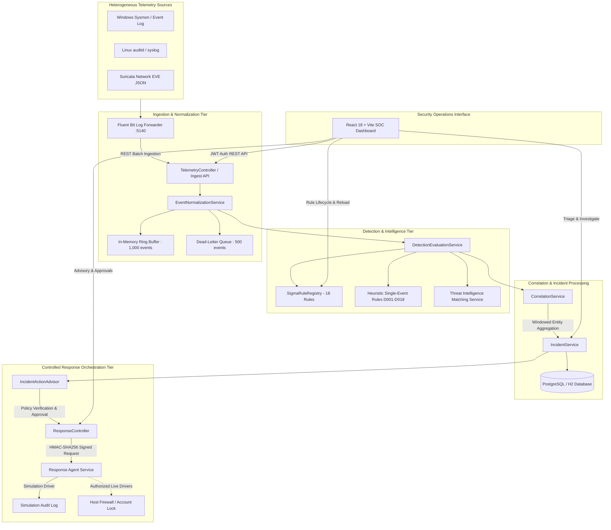

# BlueOps System Architecture & Technical Specification

**Classification:** Enterprise Threat Detection & Automated Incident Response Platform  
**System Document ID:** BLUEOPS-ARCH-001  
**Architecture Version:** 1.2.0  
**Status:** Living Engineering Specification  

---

## 1. System Overview

BlueOps is a modular, cross-platform defensive cybersecurity platform designed to unify:
1. **Multi-Source Telemetry Ingestion:** Windows Sysmon, Linux auditd/systemd, and Suricata network IDS streams.
2. **Schema Normalization:** Conversion of heterogeneous logs into a Common Event Schema (CES v1.0.0).
3. **Declarative & Heuristic Detection:** Dual-pipeline threat detection combining dynamic Sigma YAML rules with single-event rule heuristics (D001–D018).
4. **Stateful Multi-Stage Correlation:** Entity-centric cross-telemetry correlation scenarios (C001–C004) that reconstruct adversary kill-chains into actionable Incidents.
5. **Threat Intelligence Enrichment:** Autonomous IOC matching against threat indicator databases.
6. **Controlled Response Orchestration:** Cryptographically authenticated (HMAC-SHA256) modular response actions executed under strict containment and simulation guarantees.
7. **Interactive SOC Workspace:** Role-based security operations interface for telemetry investigation, incident triage, and rule management.



---

## 2. Component Breakdown

### 2.1. Backend (`backend/`)
- **Framework:** Spring Boot 3.3.4 on Java 21 (Eclipse Temurin).
- **Core Packages:**
  - `com.blueops.auth`: Authentication, JWT generation, user credentials, login rate limiting.
  - `com.blueops.security`: Security configuration, role-based access control (`ROLE_SOC_ANALYST`, `ROLE_INCIDENT_RESPONDER`, `ROLE_ADMIN`), and `SecurityStartupValidator`.
  - `com.blueops.telemetry`: `TelemetryController`, `EventNormalizationService` (CES v1.0.0 normalization, ring buffer, DLQ), and `DetectionEvaluationService`.
  - `com.blueops.detections`: `SigmaRuleParser`, `SigmaRuleRegistry`, `SigmaRuleDefinition`, and rule management APIs.
  - `com.blueops.correlation`: `CorrelationService` implementing windowed scenario correlation (C001–C004).
  - `com.blueops.incidents`: `IncidentController`, `IncidentService`, timeline construction, evidentiary tracking, status transitions.
  - `com.blueops.threatintel`: IOC indicator storage, ingestion, and synchronous telemetry matching.
  - `com.blueops.advisory`: `IncidentActionAdvisor`, rule-based playbook generation, and authoritative guidance.
  - `com.blueops.response`: `ResponseController`, `ResponseActionService`, HMAC-SHA256 payload signing, and audit history.
  - `com.blueops.assets`: Asset inventory tracking, host risk score calculation, and status tracking.
  - `com.blueops.audit`: System-wide audit log for compliance, operational tracking, and access auditing.

### 2.2. Frontend (`frontend/`)
- **Framework:** React 18 with TypeScript, Vite 5, TailwindCSS, and Lucide React icons.
- **Key Views:**
  - **SOC Overview (`DashboardPage.tsx`):** High-level operational metrics, detection velocity, active threat alerts.
  - **Live Telemetry (`LiveTelemetryPage.tsx`):** Real-time ingestion stream, filterable by host, logsource, severity, and event ID.
  - **Incident Center (`IncidentCenterPage.tsx`):** Active incident triage, severity badges, SLA tracking, and status transitions.
  - **Investigation Workspace (`InvestigationWorkspacePage.tsx`):** Detailed incident drill-down, interactive forensic timeline, evidence review.
  - **Authoritative Advisor (`AuthoritativeAdvisorPage.tsx`):** Recommended response playbooks with safety ratings and execution buttons.
  - **Detection Management (`DetectionManagementPage.tsx`):** Interactive Sigma catalog, ATT&CK mapping, and runtime disk reload trigger.
  - **Adversary Simulation Console (`AdversaryConsolePage.tsx`):** In-browser simulation runner for red-team attack scenarios.
  - **Threat Intelligence & Assets (`ThreatIntelPage.tsx`, `AssetInventoryPage.tsx`):** IOC database management and asset context.

### 2.3. Response Agent (`response-agent/`)
- **Runtime:** Python 3.11 with Flask and cryptography primitives.
- **Security Primitives:**
  - HMAC-SHA256 request signature verification using pre-shared secret keys.
  - Strict 60-second sliding timestamp validity window.
  - Nonce cache deduplication preventing replay attacks.
  - Strict action allowlist (`block_ip`, `isolate_host`, `terminate_process`, `disable_user`).
  - Target argument sanitization to prevent shell and CLI option injection.
  - Execution Drivers:
    - `SimulationDriver`: Benign execution recording in audit log (default).
    - `LinuxDriver`: Native iptables, ip route, and usermod commands.
    - `WindowsDriver`: Native netsh advfirewall and net user commands.

### 2.4. Ingestion & Infrastructure (`infrastructure/`)
- **Fluent Bit:** Log collector on port 5140 (syslog UDP/TCP) and forward port 24224 forwarding normalized JSON payloads to `/api/v1/telemetry/ingest`.
- **Sysmon:** Standard XML configuration (`sysmon-config.xml`) for Windows process creation, network connection, driver loading, and access monitoring.
- **Linux auditd:** `audit.rules` tracking root execution, privilege escalation, and system file manipulation.
- **Suricata:** EVE JSON network intrusion detection telemetry forwarder.

---

## 3. Data Flow & Event Normalization (CES v1.0.0)

All ingested telemetry is mapped into the **Common Event Schema (CES v1.0.0)** POJO (`NormalizedEvent.java`):

```json
{
  "eventId": "evt-uuid-v4",
  "timestamp": "2026-11-20T12:00:00.000Z",
  "source": "sysmon",
  "dataset": "windows.process_creation",
  "host": {
    "hostname": "WIN-ASSET-001",
    "ip": "192.168.1.105",
    "os": "windows"
  },
  "user": {
    "username": "svc_backup",
    "domain": "CORP",
    "isPrivileged": false
  },
  "process": {
    "pid": 4812,
    "name": "powershell.exe",
    "commandLine": "powershell.exe -enc SQBFAFgA...",
    "parentPid": 1204,
    "parentName": "winword.exe",
    "parentCommandLine": "winword.exe /n C:\\docs\\invoice.doc"
  },
  "network": {
    "sourceIp": "192.168.1.105",
    "sourcePort": 49152,
    "destinationIp": "198.51.100.44",
    "destinationPort": 4444,
    "protocol": "TCP"
  },
  "originalPayload": "{ ... raw unparsed syslog / json ... }"
}
```

---

## 4. Detection & Correlation Pipeline

1. **Ingest & Ring Buffer:** Telemetry arrives at `POST /api/v1/telemetry/ingest`. Events are normalized and appended to a concurrent ring buffer (`ringBufferSize = 1000`). Malformed events are routed to the DLQ (`dlqSize = 500`).
2. **Synchronous Single-Event Evaluation:** The normalized event is passed to `DetectionEvaluationService`.
   - Threat intelligence IOCs are evaluated against IPs, domains, and hashes.
   - Built-in heuristic rules (D001–D018) evaluate regex patterns on process, command line, parent process, and network endpoints.
3. **Dynamic Sigma Rule Evaluation (Target Scope):**
   - The event dataset is matched against loaded Sigma rule `logsource` filters.
   - Dynamic AST evaluation compiles rule `detection` blocks into executable predicates.
4. **Correlation:** When findings are produced, they are fed to `CorrelationService`. The correlation engine tracks findings across rolling sliding windows:
   - **C001 (Credential Access + Lateral Movement):** Detects LSASS dumping followed by remote network authentication within 15 minutes.
   - **C002 (Persistence + Priv Escalation):** Detects scheduled task creation followed by interactive root shell within 10 minutes.
   - **C003 (Phishing + C2 Egress):** Detects Office macro spawning shell followed by outbound C2 connection within 5 minutes.
   - **C004 (Ransomware Preparation):** Detects event log clearing combined with driver load and rapid file tampering.
5. **Incident Generation:** Matched correlation chains synthesize an `Incident` entity with forensic timeline entries, assigned criticality, and an initial response recommendation.

---

## 5. Architectural Boundaries & Safe Execution

- **Zero Unauthenticated Access:** All administrative and operational REST endpoints require JWT bearer tokens signed with cryptographic keys meeting minimum entropy criteria.
- **Simulation by Default:** Response orchestration defaults to `SIMULATION` mode. No live host modification (firewalling, account locking, process termination) occurs unless explicitly authorized in an isolated test environment.
- **Fail-Safe Startup:** The application halts boot in production mode if insecure default credentials or low-entropy secrets are detected.
