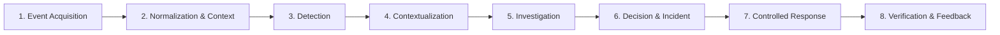
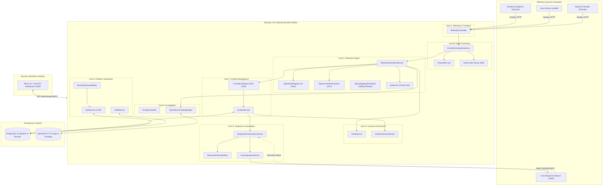
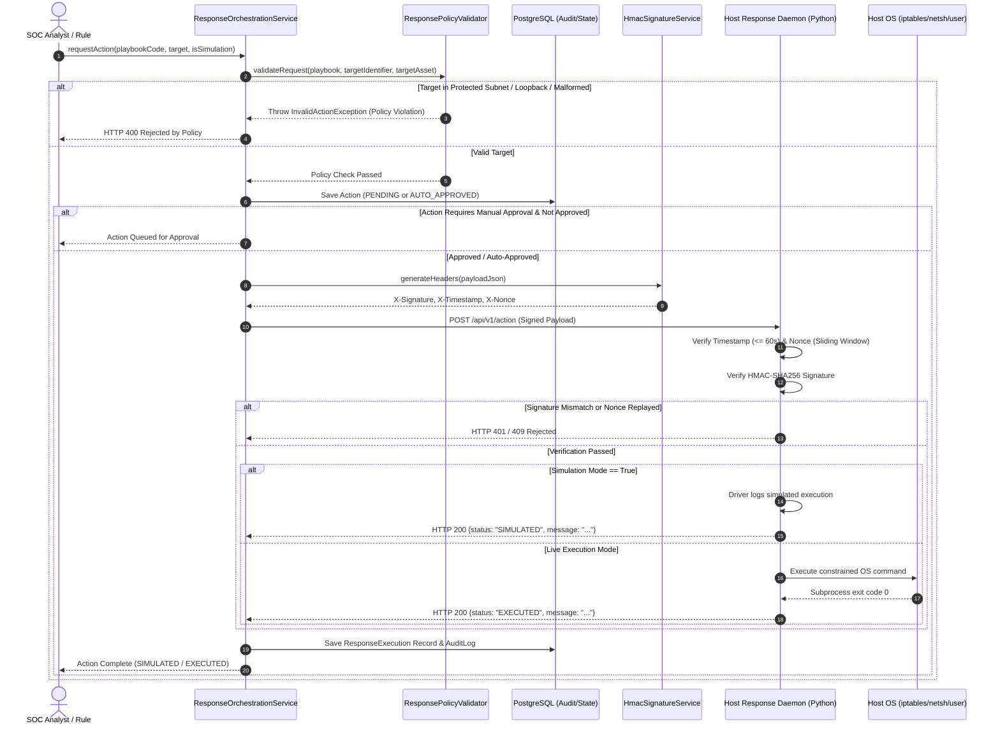

# BLUEOPS ARCHITECTURE: THE OPERATIONAL SPINE & SYSTEM SPECIFICATION

**Document Version:** 2.0.0  
**Classification:** Defensive Cybersecurity Operations Platform  
**Target Architecture:** Modular Monolith with Decoupled Response Daemon  
**System Document ID:** BLUEOPS-ARCH-2026-001  

---

## 1. PRODUCT IDENTITY & MISSION

**BlueOps** is an open-source, modular defensive cybersecurity operations platform that unifies security telemetry ingestion, normalization, detection, correlation, incident management, threat intelligence, and controlled defensive response orchestration.

The platform is designed to overcome the fragmentation between security telemetry log collectors, SIEM detection rules, correlation engines, and SOAR response scripts. Instead of treating these as disparate microservices or disconnected tools, BlueOps unifies them around a **single continuous operational spine**.

### Core Value Proposition
1. **Evidence-Driven Operation:** Every incident, finding, and response action maintains strict provenance and traceability back to canonical normalized events and raw telemetry.
2. **Deterministic & Explainable Detection:** Threat detection combines dynamic Sigma rule evaluation with stateful multi-stage correlation, providing explicit matching metadata and MITRE ATT&CK mapping.
3. **Controlled & Policy-Bounded Response:** SOAR capabilities enforce cryptographic authentication (HMAC-SHA256), replay protection, boundary validation against critical infrastructure, and mandatory simulation mode prior to live execution.
4. **Resilient Dual-Store Architecture:** Relational system-of-record integrity via PostgreSQL paired with high-performance telemetry indexing and full-text search via OpenSearch.

---

## 2. THE ARCHITECTURAL SPINE

BlueOps is organized around one primary operational lifecycle:



Every subsystem, API endpoint, database entity, and user interface in BlueOps exists exclusively to serve or support this lifecycle. Any feature that does not directly map to this spine is excluded from the core platform.

### Lifecycle Stages & Architectural Responsibilities

| Stage | Operational Objective | System Component | Data Transformation |
| :--- | :--- | :--- | :--- |
| **Stage 1: Event Acquisition** | Ingest heterogeneous telemetry streams (Sysmon, auditd, Suricata) reliably over syslog, HTTP, or agent forwarders. | `Fluent Bit` (UDP/TCP: 5140) $\rightarrow$ `TelemetryController` (`/api/v1/telemetry/ingest`) | Raw JSON / Syslog strings $\rightarrow$ Ingestion DTO |
| **Stage 2: Normalization & Context** | Parse, validate, and standardize raw logs into the Common Event Schema (CES v1.0.0) while preserving raw evidence. Route corrupt events to the Dead-Letter Queue (DLQ). | `EventNormalizationService`, In-Memory Ring Buffer (1,000 events), DLQ (500 events) | Raw payload $\rightarrow$ `NormalizedEvent` (CES v1.0.0) |
| **Stage 3: Detection** | Evaluate normalized events against dynamic Sigma rules, regex heuristics (D001–D018), and threat intelligence IOC indicators. | `DetectionEvaluationService`, `SigmaDetectionEvaluator`, `IocService` | `NormalizedEvent` $\rightarrow$ `List<FindingDto>` |
| **Stage 4: Contextualization** | Enrich findings with asset inventory metadata, criticality rankings, network topology, and authoritative advisories. | `AssetService`, `IncidentAdvisoryService`, `OpenSearchFindingAdapter` | `FindingDto` $\rightarrow$ Enriched Finding Record |
| **Stage 5: Investigation** | Allow SOC analysts to drill down into triggering evidence, raw events, parent-child process trees, and temporal event graphs. | `FindingController`, `TelemetryController`, SOC Investigation Workspace UI | Query parameters $\rightarrow$ Evidence timelines & graph models |
| **Stage 6: Decision & Incident** | Correlate multi-stage finding chains into stateful Incidents (`INC-YYYY-XXXX`). Track assignment, status transitions, and investigative notes. | `CorrelationEngine` (C001, C002), `IncidentService`, PostgreSQL `Incident` | `List<FindingDto>` $\rightarrow$ `Incident` (State: NEW) |
| **Stage 7: Controlled Response** | Validate proposed containment actions against safety policies, require manual approval for critical assets, sign execution payloads with HMAC-SHA256, and dispatch to response agents. | `ResponseOrchestrationService`, `ResponsePolicyValidator`, `HmacSignatureService` | `Incident` $\rightarrow$ `ResponseAction` $\rightarrow$ Signed Agent Payload |
| **Stage 8: Verification & Feedback** | Record agent execution telemetry, verify post-action state changes on target hosts, and maintain an immutable audit trail. | `ResponseExecution`, `AuditService`, Target OS Driver confirmation | Agent Response JSON $\rightarrow$ `ResponseExecution` & `AuditLog` |

---

## 3. CORE PLATFORM SUBSYSTEMS

The platform is structured into eight logically cohesive core subsystems running inside a modular monolith backend, accompanied by an isolated host response agent and an administrative operations UI.



### Core Subsystem Responsibilities & Boundaries

#### Core A — Telemetry & Transport (`com.blueops.telemetry`)
- **Primary Responsibility:** Accept raw event batches from forwarders (Fluent Bit) or API clients.
- **Invariants:** Must reject unauthenticated ingestion unless explicitly running on a secured internal management network. Never drops events silently.
- **API Surface:** `POST /api/v1/telemetry/ingest`, `GET /api/v1/telemetry/stats`.

#### Core B — Event Processing (`com.blueops.telemetry`)
- **Primary Responsibility:** Normalize raw payloads into the Common Event Schema (CES v1.0.0). Maintain bounded in-memory sliding window and dead-letter queue.
- **Invariants:** Normalization is non-destructive; the raw event is preserved in `event.original`. Corrupted payloads are routed to DLQ with error causes.
- **API Surface:** `GET /api/v1/telemetry/events`, `GET /api/v1/telemetry/dlq`, `POST /api/v1/telemetry/dlq/replay`, `DELETE /api/v1/telemetry/dlq`.

#### Core C — Detection Engine (`com.blueops.detections`, `com.blueops.detections.sigma`)
- **Primary Responsibility:** Parse Sigma YAML rule definitions, maintain thread-safe rule registry, compile condition expressions into Boolean Abstract Syntax Trees (ASTs), and execute field-matching against incoming events.
- **Invariants:** Rule evaluation must be deterministic and side-effect free. Dynamic reloading must swap rule maps atomically.
- **API Surface:** `GET /api/v1/detections/rules`, `POST /api/v1/detections/rules`, `POST /api/v1/detections/rules/reload`.

#### Core D — Context & Enrichment (`com.blueops.assets`, `com.blueops.threatintel`, `com.blueops.advisory`)
- **Primary Responsibility:** Maintain asset inventories with criticality classifications, correlate IOC hashes/IPs/domains against threat feeds, and generate authoritative guidance (NIST/CISA/MITRE).
- **Invariants:** Uninventoried assets must receive default non-privileged status; threat intelligence matches must cite feed source and confidence.
- **API Surface:** `/api/v1/assets`, `/api/v1/threat-intel`, `/api/v1/advisory`.

#### Core E — Investigation (`com.blueops.findings`)
- **Primary Responsibility:** Provide fast retrieval, filtering, and inspection of generated security findings, related finding correlation, and underlying forensic evidence provenance.
- **Invariants:** Findings are immutable once generated. Every finding links to an originating detection rule ID and related event doc ID. Finding status dynamically synchronizes with incident association (`OPEN` $\leftrightarrow$ `LINKED_TO_INCIDENT`).
- **API Surface:** `GET /api/v1/detections/findings`, `GET /api/v1/detections/findings/{id}`, `GET /api/v1/detections/findings/{id}/evidence`, `GET /api/v1/detections/findings/{id}/related`.

#### Core F — Incident Management (`com.blueops.incidents`)
- **Primary Responsibility:** Model the complete life cycle of security incidents (`NEW`, `TRIAGED`, `INVESTIGATING`, `CONTAINMENT_PENDING`, `CONTAINED`, `RESOLVED`, `CLOSED`, `FALSE_POSITIVE`, `REOPENED`). Support multi-finding association, raw evidence aggregation, analyst assignment/unassignment, validated analyst notes, and chronological timeline generation.
- **Invariants:** All status transitions are recorded with actor, timestamp, and rationale. State machine transitions are strictly validated. Transitions to `RESOLVED` require `resolutionRationale`. Transitions to `CLOSED` require formal review notes (`closureNotes`) and prior resolved/false-positive state.
- **API Surface:** `GET /api/v1/incidents`, `POST /api/v1/incidents`, `PATCH /api/v1/incidents/{id}/status`, `PATCH /api/v1/incidents/{id}/assign`, `POST /api/v1/incidents/{id}/notes`, `GET /api/v1/incidents/{id}/evidence`, `POST /api/v1/incidents/{id}/findings`, `DELETE /api/v1/incidents/{id}/findings/{findingId}`, `GET /api/v1/incidents/{id}/timeline`.

#### Core G — Response Orchestration (`com.blueops.response`)
- **Primary Responsibility:** Manage response action catalog, enforce safety bounds and approval requirements, sign agent payloads with HMAC-SHA256, track execution status, and verify target host outcomes.
- **Invariants:** Actions default to simulation mode unless explicitly approved. Protected resources (loopback, gateway, critical servers) cannot be blocked. Every action has an undo/rollback definition.
- **API Surface:** `GET /api/v1/response/playbooks`, `POST /api/v1/response/actions`, `POST /api/v1/response/actions/{id}/approve`, `POST /api/v1/response/actions/{id}/rollback`.

#### Core H — Platform Operations (`com.blueops.security`, `com.blueops.auth`, `com.blueops.audit`)
- **Primary Responsibility:** Authentication (JWT), role-based access control (`ROLE_ADMIN`, `ROLE_ANALYST`, `ROLE_VIEWER`), startup cryptographic validation, audit event logging, and container health checks.
- **Invariants:** Fail-secure startup on weak credentials or missing configuration; append-only audit trail.
- **API Surface:** `/api/v1/auth/login`, `/api/v1/auth/refresh`, `/api/v1/audit`, `/actuator/health`.

---

## 4. ARCHITECTURAL INVARIANTS

The following ten invariants are non-negotiable architectural constraints for all development on BlueOps:

1. **The Spine Is Mandatory:** Every feature, service, or API must map to a stage of the 8-stage operational spine. Disconnected or orphaned features will be rejected.
2. **No Disconnected Functionality:** A module is incomplete if it possesses only a database schema or UI mock. It must be integrated into the live event-to-action flow.
3. **Reuse Existing Mature Technologies:** Never write custom storage, search, or forwarder infrastructure when PostgreSQL, OpenSearch, and Fluent Bit satisfy the requirement. Focus engineering on orchestration, correlation, and response safety.
4. **Distinct Identity Through Integration & Safety:** BlueOps establishes its value in the seamless bridge between detection and safe response—specifically policy enforcement, simulation guarantees, and authoritative mitigation guidance.
5. **Avoid Monolithic Accumulation:** Maintain strict package boundaries within the Spring Boot application (`com.blueops.<subsystem>`). Do not introduce circular dependencies across domain packages.
6. **Avoid Premature Microservices:** Maintain the core backend as a modular monolith. Avoid distributed network calls, distributed transactions, and multiple container orchestration overheads where simple in-process Java service calls provide higher throughput and stronger transactional integrity.
7. **Every Subsystem Must Have a Contract:** All data passing across subsystem boundaries must use strongly typed DTOs and adhere to published data contracts (see `BLUEOPS_DATA_CONTRACTS.md`).
8. **Preserve Provenance:** Normalization must never discard original telemetry. Findings must reference triggering rule versions and raw event identifiers.
9. **Fail Safely & Fail Closed:** Parsing failures route to the DLQ; policy validation failures block response execution; missing authentication terminates the request immediately.
10. **Zero Unsubstantiated Claims:** Benchmark numbers, detection rates, and performance statistics must be backed by reproducible automated suites in `test-lab/`.

---

## 5. PERSISTENCE & DUAL-STORE STRATEGY

BlueOps employs an explicit dual-store architecture with clearly delineated data ownership:

```
+-------------------------------------------------------------------------+
|                               BLUEOPS BACKEND                           |
+------------------------------------+------------------------------------+
                                     |
                +--------------------+--------------------+
                |                                         |
     [ Authoritative Relational ]                [ Log & Finding Index ]
                |                                         |
                v                                         v
       +-----------------+                       +-----------------+
       |   PostgreSQL    |                       |   OpenSearch    |
       +-----------------+                       +-----------------+
       | - User accounts |                       | - Raw telemetry |
       | - RBAC roles    |                       | - CES events    |
       | - Incidents     |                       | - Findings      |
       | - Playbooks     |                       | - Inverted text |
       | - Audit logs    |                       | - Aggregations  |
       | - Assets        |                       |                 |
       +-----------------+                       +-----------------+
```

- **PostgreSQL 16 (System of Record):** Authoritative storage for relational entities requiring ACID guarantees, transactional state transitions, foreign keys, and cryptographic auditability (users, incidents, playbooks, action executions, audit records). Schema managed strictly via Flyway migrations (`db/migration/V*`).
- **OpenSearch 2.13 (Search & Telemetry Index):** Inverted-index storage optimized for high-volume time-series log ingestion, full-text search across arbitrary event fields, and high-cardinality aggregation queries. Index templates configured in `infrastructure/opensearch/index-templates/`.
- **Fault-Tolerant Degraded Operation:** If OpenSearch is temporarily unreachable, the `OpenSearchFindingAdapter` automatically falls back to an internal thread-safe in-memory cache, ensuring that detection evaluation and incident creation continue uninterrupted.

---

## 6. CONTROLLED RESPONSE & SECURITY BOUNDARIES

The response subsystem represents the highest operational risk in BlueOps. To guarantee safety and prevent accidental service disruption or weaponization, execution is strictly compartmentalized:



### Safety Controls Enforced at Every Execution:
1. **Simulation Default:** The system default is `simulation-mode: true`. Live execution requires explicit configuration and administrator privilege.
2. **Pre-Execution Policy Validation:** `ResponsePolicyValidator` blocks any action attempting to isolate `127.0.0.1`, `localhost`, default gateways, or active BlueOps controller nodes.
3. **Mandatory Approval for Critical Assets:** Any action targeting an asset flagged with `criticality: CRITICAL` is forced into `PENDING` state, requiring secondary human authorization.
4. **Anti-Replay & Integrity:** All agent communications are signed with HMAC-SHA256. Nonces are cached in a sliding time window (60 seconds) to prevent replay attacks.
5. **Reversibility Guarantee:** Every playbook in `ResponsePlaybook` must declare a corresponding rollback action (`block_ip` $\rightarrow$ `restore_ip`; `disable_user` $\rightarrow$ `enable_user`).

---

## 7. DEPLOYMENT TOPOLOGIES

### Topology 1: Single-Node Engineering / Evaluation Lab
- Deployed via `docker-compose.yml`.
- All services (`postgres`, `opensearch`, `opensearch-dashboards`, `fluent-bit`, `backend`, `frontend`, `response-agent`) run on a single Docker bridge network (`blueops-net`).
- Host resource footprint: 4 vCPUs, 6 GB RAM.

### Topology 2: Distributed Production Environment
- **Ingestion Tier:** Fluent Bit daemonsets deployed across client endpoints, forwarding to external load balancers.
- **Data Tier:** Managed PostgreSQL cluster (Multi-AZ) and managed OpenSearch service.
- **Application Tier:** Stateless BlueOps backend replicas running behind reverse proxies (Nginx / Cloudflare).
- **Endpoint Tier:** Standalone `blueops-response-agent` running as a systemd service or Windows Service on managed endpoints, communicating over mutually authenticated TLS with HMAC payload verification.
