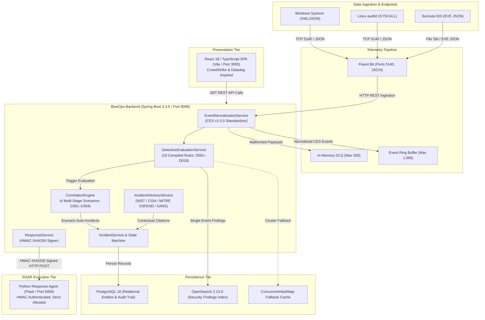

# BLUEOPS TECHNICAL AUDIT: SYSTEM ARCHITECTURE REPORT
**Document ID:** BLUEOPS-AUDIT-ARCH-001  
**Scope:** Architecture Reconstruction, Component Interaction, Pipeline Lifecycles, and Complete REST API Inventory  
**Target Codebase:** `blueops-defense-cloud`  
**Classification:** Technical Due Diligence & Implementation Audit  

---

## 1. System Topology & Architectural Style

### 1.1. High-Level Architectural Pattern
Contrary to initial high-level marketing descriptions implying a complex Kubernetes microservices mesh, the audited BlueOps platform is architected as an **Enterprise Modular Monolith** in Java 21 / Spring Boot 3.3.5, supported by satellite ingestion and execution containers.

This architectural pattern is a well-founded engineering decision for a cybersecurity SIEM/SOAR system:
* **Zero Distributed Latency:** Critical in-memory pipeline operations (normalization, regex rule evaluation, sliding-window correlation) execute with nanosecond-level overhead without distributed network hops or serialization penalties.
* **ACID Integrity:** Incident creation, finding associations, timeline note additions, and state-machine transitions operate under single-database transactions (`@Transactional`).
* **Operational Simplicity:** Avoids Kubernetes orchestration complexity, service meshes, and distributed tracing overhead, deploying cleanly via Docker Compose.

### 1.2. Component Interaction & Communication Diagram



---

## 2. Backend Architecture Deep-Dive

The backend (`backend/src/main/java/com/blueops`) is structured into strict domain packages adhering to separation of concerns:

```
com.blueops
├── advisory/       # Deterministic regulatory advisory expert system (NIST, CISA, MITRE)
├── assets/         # Monitored host inventory and telemetry status tracking
├── audit/          # Administrative action and security compliance audit trails
├── auth/           # JWT session management, login rate limiting, and RBAC
├── common/         # Standard API wrappers, paging, global exception handling, and Flyway init
├── detections/     # DetectionRule entities, repository, and correlation engine
├── findings/       # OpenSearch finding adapter with in-memory resilient fallback
├── incidents/      # Incident lifecycle management, notes, timeline, and strict state machine
├── reporting/      # SOC operational health metrics and MITRE ATT&CK coverage calculation
├── response/       # SOAR response actions, HMAC signing, and playbook management
├── security/       # Spring Security filters, JWT token parsing, and role authorities
├── telemetry/      # Event ingestion, normalization to CES v1.0.0, DLQ, and evaluation
└── threatintel/    # IOC indicator management, confidence scoring, and telemetry matching
```

### 2.1. Layered Responsibilities
1. **Controllers (`*Controller.java`):** REST API entry points configured with Spring Doc OpenAPI annotations (`@Tag`, `@Operation`), input validation (`@Valid`), and method-level security (`@PreAuthorize`).
2. **Services (`*Service.java`):** Transactional business logic boundaries (`@Transactional`). Coordinates between persistence repositories, cryptographic signers, and caching adapters.
3. **Repositories (`*Repository.java`):** Spring Data JPA interfaces backed by Hibernate.
4. **Entities (`*.java`):** Relational models mapped to PostgreSQL tables (`incidents`, `incident_findings`, `incident_notes`, `incident_status_history`, `assets`, `detection_rules`, `audit_logs`, `threat_intel_iocs`, `response_actions`, `users`).
5. **Data Transfer Objects (`*Dto.java`, `*Request.java`):** Clean domain encapsulation preventing internal Hibernate entity leakage across the REST interface.

---

## 3. Telemetry Ingestion & Normalization Pipeline

### 3.1. Telemetry Ingestion Architecture
Telemetry enters the system through two complementary pathways:
* **Production Pathway:** Fluent Bit (`infrastructure/fluent-bit/fluent-bit.conf`) accepts TCP syslog / JSON on port 5140, forward protocol on port 24224, and tails `/var/log/suricata/eve.json`. Fluent Bit injects routing tags and ships batches to OpenSearch on port 9200 (`blueops-events-%Y.%m.%d`).
* **Application Pathway:** Direct HTTP POST requests to `/api/v1/telemetry/ingest` handled by `TelemetryController.java` $\to$ `EventNormalizationService.java`.

### 3.2. Common Event Schema (CES v1.0.0) Normalization
`EventNormalizationService.java` inspects incoming JSON payloads to identify the telemetry provider dynamically:
* **Sysmon:** Detected via `EventID` or `Sysmon` fields. Extracts `Image`, `CommandLine`, `ParentCommandLine`, `Computer`, and converts Windows UTC timestamps (`yyyy-MM-dd HH:mm:ss[.SSS]`).
* **Linux auditd:** Detected via `audit_type`, `auditd`, or `SYSCALL`. Parses `execve`, `comm`, `proctitle`, `cwd`, and command arguments into standard process metadata.
* **Suricata:** Detected via `event_type` or `suricata`. Normalizes network 5-tuples (`src_ip`, `dest_ip`, `dest_port`), transport protocols, and alert signatures.

**Normalized CES Schema Structure:**
* `id` (UUID): Unique event identifier.
* `timestamp` (Instant): Standardized ISO-8601 UTC timestamp.
* `event`: Metadata container holding provider, dataset, category, action, numeric severity (1–4), and `original` (unparsed raw payload preserved for forensic admissibility).
* `host`: Host identifier, hostname, IP address, and detected OS (`Windows`, `Linux`, `FreeBSD`).
* `process`: Target process PID, PPID, executable name, command-line arguments, and recursive parent process metadata.
* `user`: Username, user ID, and domain.
* `file`: Target file path, name, extension, size, and MD5/SHA256 hashes.
* `source` / `destination`: Network endpoints (IP address, port, domain).
* `network`: Layer 4 protocol (`TCP`, `UDP`, `ICMP`), transport, and direction (`inbound`, `outbound`).

### 3.3. Pipeline Buffering & Dead-Letter Queue (DLQ) Resilience
To prevent unbounded heap exhaustion while ensuring zero silent event loss:
* **Recent Events Buffer:** Maintained in a `ConcurrentLinkedDeque<NormalizedEvent>` capped at `MAX_BUFFER_SIZE = 1,000`.
* **Dead-Letter Queue (DLQ):** When malformed or corrupted telemetry triggers a parsing exception (e.g., type casting errors), the raw payload and exact stack trace are routed to an in-memory DLQ capped at `MAX_DLQ_SIZE = 500`.
* **DLQ Observability:** Exposed via `GET /api/v1/telemetry/dlq` with query parameter clamping (`Math.max(1, Math.min(limit, 100))`) to prevent denial-of-service via huge pagination queries.

---

## 4. Detection & Correlation Subsystems

### 4.1. Single-Event Detection Rules (D001–D018)
Single-event threat detection is executed synchronously inside `DetectionEvaluationService.java`.

**Key Architectural Finding:** While the repository contains 18 well-formed Sigma YAML files in `detection-rules/sigma/`, the runtime evaluation engine **does not compile these YAML files dynamically**. Instead, the detection logic is hardcoded in Java using pre-compiled regex patterns:
* **D001:** Repeated SSH Authentication Failures (Linux, T1110)
* **D002:** Successful SSH Authentication Following Failures (Linux, T1078)
* **D003:** Sudo Execution Without TTY (Linux, T1548.003)
* **D004:** Interactive Root Shell Spawned From Sudo (Linux, T1548.003)
* **D005:** Creation of Unauthorized Local User Account (Linux/Windows, T1136.001)
* **D006:** Linux Audit Subsystem Tampering (`auditctl -D`) (Linux, T1562.001)
* **D007:** Suspicious System Service Creation in `/etc/systemd/system` (Linux, T1543.002)
* **D008:** Suspicious Encoded PowerShell Execution or Download Cradle (Windows, T1059.001)
* **D009:** Office Application Spawning Command Interpreter (Windows, T1059)
* **D010:** Scheduled Task Creation via Command Line (Windows, T1053.005)
* **D011:** LSASS Memory Access / Mimikatz Comsvcs Dumping (Windows, T1003.001)
* **D012:** Unexpected Driver Loading Activity (Windows/Linux, T1543.003)
* **D013:** Security Event Log Clearing (`wevtutil cl`) (Windows, T1070.001)
* **D014:** Outbound Connection to Non-Standard High Port (Network, T1071.001)
* **D015:** Connection to Known Threat Intelligence IOC (Network, T1071)
* **D016:** Protected-File / System Key Modification (`hosts`, Registry Run) (Windows/Linux, T1565.001 / T1547.001)
* **D017:** Repeated Authentication Failures From Single Source (Network, T1110)
* **D018:** Unusual Administrative Service Masquerading (`svchost.exe` outside `system32`) (Windows, T1569.002)

### 4.2. Temporal Multi-Stage Correlation Engine (C001–C004)
`CorrelationEngine.java` evaluates collections of findings associated with a specific asset over a 24-hour sliding temporal horizon:
* **C001 (Linux Compromise & Escalation):** Correlates SSH failures (`D001`) $\to$ successful login (`D002`) $\to$ root shell spawn (`D004`).
* **C002 (Windows Execution Chain):** Correlates Office spawning cmd/powershell (`D009`) $\to$ encoded PowerShell execution (`D008`) $\to$ anomalous outbound network connection (`D014`).
* **C003 (IOC Multi-Stage Threat):** Correlates high-confidence threat intelligence match (`D015`) $\to$ secondary endpoint activity (`D008`, `D011`, or `D014`).
* **C004 (Account & Persistence Manipulation):** Correlates unauthorized account creation (`D005`) $\to$ system service or scheduled task installation (`D007`, `D010`, or `D018`).

**Automated Incident Promotion:** When a correlated scenario matches, `CorrelationEngine` automatically triggers `IncidentService.createIncidentFromScenario()`, creating a formal investigation record with `CRITICAL` or `HIGH` severity.

---

## 5. Authoritative SecOps Advisory Subsystem

Rather than querying non-deterministic external LLMs (which introduce token costs, API latency, network dependency, and hallucination risks), BlueOps implements a deterministic, citation-backed expert advisory system (`IncidentAdvisoryService.java` & `AdvisoryKnowledgeBase.java`).

### 5.1. Grounding in Authoritative Standards
Every recommendation generated by the advisory system carries an explicit, legally and procedurally verifiable citation to one of four authoritative bodies:
1. **NIST SP 800-61 Rev. 2:** Computer Security Incident Handling Guide (Preparation, Detection & Analysis, Containment, Eradication & Recovery, Post-Incident Activity).
2. **CISA Federal Incident Response Playbooks (2021/2023):** Standardized containment workflows for network perimeter drops and compromised credential revocation.
3. **MITRE ATT&CK & MITRE D3FEND:** Direct technical countermeasure mappings (e.g., `D3-NTF` Network Traffic Filtering, `D3-IAA` Inbound Authentication Analysis).
4. **SANS PICERL & RFC 3227:** Evidence handling guidelines and volatile memory preservation prior to host shutdown.

### 5.2. Rule Synthesis Engine
`IncidentAdvisoryService.generateRecommendations(incidentId)` analyzes the incident's attached detection rules, MITRE technique IDs, target asset operating system, and extracted IOCs to assemble a prioritized triage playbook:
* Prioritizes actions into `IMMEDIATE_ACTION`, `HIGH_PRIORITY`, and `STANDARD_WORKFLOW`.
* Classifies recommendations by lifecycle phase: `CONTAINMENT`, `ERADICATION`, `EVIDENCE_PRESERVATION`, `INVESTIGATION`, or `RECOVERY`.
* Cross-references executable response playbooks (e.g., recommending playbook `P001: BLOCK_IP` with pre-populated target IP parameters).

---

## 6. SOAR & Active Response Subsystem

### 6.1. Response Workflow Architecture
The response orchestration pipeline implements a dual-stage human-in-the-loop authorization workflow:
1. **Proposal / Request:** Analyst or Advisory Service creates a `ResponseAction` via `POST /api/v1/response/actions` in `PENDING_APPROVAL` status.
2. **Approval:** SOC Administrator approves via `POST /api/v1/response/actions/{id}/approve`, transitioning status to `APPROVED`.
3. **Cryptographic Dispatch:** Administrator triggers `POST /api/v1/response/actions/{id}/execute`. `ResponseService.java` serializes the payload, generates an HMAC-SHA256 signature, and dispatches an HTTP POST to the response agent on port 5000.
4. **Compensating Rollback:** Reversible playbooks (e.g., `ISOLATE_HOST`) support 1-click compensating execution via `POST /api/v1/response/actions/{id}/rollback`, dispatching the counter-action (`RECONNECT_HOST`).

### 6.2. Cryptographic Security Boundary
Communication between the Spring Boot backend and the Python response agent (`response-agent/src/agent.py`) is enforced via `HmacSignatureService.java`:
* **HMAC-SHA256 Signature:** Generated using a shared secret (`RESPONSE_AGENT_SECRET`). Signature covers timestamp + payload (`timestamp + ":" + payload`).
* **Anti-Replay Window:** Enforces a strict 60-second validity window (`abs(now - timestamp) > 60`).
* **Nonce / Action UUID Deduplication:** The agent caches processed `ActionId` nonces in memory (capped at 10,000 entries) and rejects duplicate IDs with HTTP 409 Conflict.
* **Strict Parameter Sanitization:** Target values are validated against `FORBIDDEN_TARGET_PATTERN = re.compile(r"[;&|`$><\r\n]")`. Payloads containing command injection metacharacters are rejected with HTTP 400.
* **Allowlisted Action Constraints:** Execution is strictly limited to 7 allowlisted actions (`BLOCK_IP`, `RESTORE_IP`, `DISABLE_USER`, `ENABLE_USER`, `ISOLATE_HOST`, `RECONNECT_HOST`, `COLLECT_EVIDENCE`). Arbitrary commands are rejected.

---

## 7. Persistence & Data Tier

### 7.1. Relational Tier (PostgreSQL 16)
Database migrations are versioned via Flyway:
* **`V1__initial_schema.sql`:** DDL establishing core tables (`assets`, `detection_rules`, `incidents`, `incident_findings`, `incident_notes`, `incident_status_history`, `audit_logs`, `threat_intel_iocs`, `response_actions`, `users`).
* **`V2__seed_initial_data.sql`:** DML seeding 18 detection rules, 8 threat intelligence IOCs, 4 monitored lab assets, 7 response playbooks, and 2 default user accounts (`admin`, `analyst`) with BCrypt-hashed passwords.

### 7.2. Finding & Telemetry Index Tier (OpenSearch 2.13.0 & Fallback Cache)
OpenSearch integration is encapsulated in `OpenSearchFindingAdapter.java`:
* Queries index pattern `blueops-findings-*` via Spring `RestTemplate`.
* **Automatic Resilience Fallback:** If the OpenSearch cluster is offline or unreachable (`ResourceAccessException`), the adapter gracefully catches the exception and serves queries from an internal thread-safe `ConcurrentHashMap<String, FindingDto>`.

---

## 8. Complete REST API Inventory

The BlueOps backend exposes **39 REST endpoints** across **11 Spring controllers**:

| Controller | Method | Path | Required Role / Auth | Service Method Invoked | Target Persistence / System | Status |
| :--- | :--- | :--- | :--- | :--- | :--- | :--- |
| **AdvisoryController** | `GET` | `/api/v1/advisory/incidents/{incidentId}/recommendations` | Authenticated | `IncidentAdvisoryService.generateRecommendations` | PostgreSQL (`incidents`) & OpenSearch | **VERIFIED WORKING** |
| | `POST` | `/api/v1/advisory/analyze` | Authenticated | `IncidentAdvisoryService.analyzeAdHoc` | In-memory advisory knowledge base | **VERIFIED WORKING** |
| **AssetController** | `GET` | `/api/v1/assets` | Authenticated | `AssetService.getAllAssets` | PostgreSQL (`assets`) | **VERIFIED WORKING** |
| | `GET` | `/api/v1/assets/{id}` | Authenticated | `AssetService.getAssetById` | PostgreSQL (`assets`) | **VERIFIED WORKING** |
| | `POST` | `/api/v1/assets` | `ADMIN`, `ANALYST` | `AssetService.createAsset` | PostgreSQL (`assets`) & Audit Log | **VERIFIED WORKING** |
| | `PUT` | `/api/v1/assets/{id}` | `ADMIN`, `ANALYST` | `AssetService.updateAsset` | PostgreSQL (`assets`) & Audit Log | **VERIFIED WORKING** |
| | `DELETE` | `/api/v1/assets/{id}` | `ADMIN` | `AssetService.deleteAsset` | PostgreSQL (`assets`) & Audit Log | **VERIFIED WORKING** |
| | `GET` | `/api/v1/assets/{id}/history` | Authenticated | `AssetService.getAssetHistory` | PostgreSQL (`assets`) | **VERIFIED WORKING** |
| **AuditController** | `GET` | `/api/v1/audit/logs` | `ADMIN`, `ANALYST` | `AuditService.getAuditLogs` | PostgreSQL (`audit_logs`) | **VERIFIED WORKING** |
| | `GET` | `/api/v1/audit/logs/{id}` | `ADMIN`, `ANALYST` | `AuditService.getLogById` | PostgreSQL (`audit_logs`) | **VERIFIED WORKING** |
| **AuthController** | `POST` | `/api/v1/auth/login` | Permit All | `AuthService.login` | BCrypt verify & JWT issue | **VERIFIED WORKING** |
| | `POST` | `/api/v1/auth/refresh` | Permit All | `AuthService.refreshToken` | Refresh token validation | **VERIFIED WORKING** |
| | `POST` | `/api/v1/auth/logout` | Authenticated | `AuthService.logout` | Audit log record (stateless JWT) | **VERIFIED WORKING** |
| | `GET` | `/api/v1/auth/me` | Authenticated | `AuthService.getCurrentUser` | In-memory Principal lookup | **VERIFIED WORKING** |
| **DetectionRuleController** | `GET` | `/api/v1/detections` | Authenticated | `DetectionRuleService.getAllRules` | PostgreSQL (`detection_rules`) | **VERIFIED WORKING** |
| | `GET` | `/api/v1/detections/{id}` | Authenticated | `DetectionRuleService.getRuleById` | PostgreSQL (`detection_rules`) | **VERIFIED WORKING** |
| | `PUT` | `/api/v1/detections/{id}/status` | `ADMIN` | `DetectionRuleService.updateRuleStatus` | PostgreSQL (`detection_rules`) & Audit | **VERIFIED WORKING** |
| | `GET` | `/api/v1/detections/summary` | Authenticated | `DetectionRuleService.getDetectionsSummary`| PostgreSQL (`detection_rules`) | **VERIFIED WORKING** |
| **FindingController** | `GET` | `/api/v1/detections/findings` | Authenticated | `FindingService.getAllFindings` | OpenSearch finding adapter | **VERIFIED WORKING** |
| | `GET` | `/api/v1/detections/{id}/findings` | Authenticated | `FindingService.getFindingsByRule` | OpenSearch finding adapter | **VERIFIED WORKING** |
| **IncidentController** | `GET` | `/api/v1/incidents` | Authenticated | `IncidentService.getIncidents` | PostgreSQL (`incidents`) | **VERIFIED WORKING** |
| | `POST` | `/api/v1/incidents` | `ADMIN`, `ANALYST` | `IncidentService.createIncident` | PostgreSQL (`incidents`) & Audit | **VERIFIED WORKING** |
| | `GET` | `/api/v1/incidents/{id}` | Authenticated | `IncidentService.getIncidentById` | PostgreSQL (`incidents`) | **VERIFIED WORKING** |
| | `GET` | `/api/v1/incidents/{id}/timeline` | Authenticated | `IncidentService.getIncidentTimeline` | PostgreSQL (`incident_notes`, etc.) | **VERIFIED WORKING** |
| | `GET` | `/api/v1/incidents/{id}/findings` | Authenticated | `IncidentService.getIncidentFindings` | PostgreSQL (`incident_findings`) | **VERIFIED WORKING** |
| | `POST` | `/api/v1/incidents/{id}/findings` | `ADMIN`, `ANALYST` | `IncidentService.attachFinding` | PostgreSQL (`incident_findings`) | **VERIFIED WORKING** |
| | `POST` | `/api/v1/incidents/{id}/notes` | `ADMIN`, `ANALYST` | `IncidentService.addNote` | PostgreSQL (`incident_notes`) | **VERIFIED WORKING** |
| | `PUT` | `/api/v1/incidents/{id}/assign` | `ADMIN`, `ANALYST` | `IncidentService.assignIncident` | PostgreSQL (`incidents`) & Audit | **VERIFIED WORKING** |
| | `PUT` | `/api/v1/incidents/{id}/status` | `ADMIN`, `ANALYST` | `IncidentService.updateStatus` | PostgreSQL state machine & Audit | **VERIFIED WORKING** |
| | `POST` | `/api/v1/incidents/{id}/reopen` | `ADMIN`, `ANALYST` | `IncidentService.reopenIncident` | PostgreSQL state machine & Audit | **VERIFIED WORKING** |
| **ReportingController** | `GET` | `/api/v1/reports/overview` | Authenticated | `ReportingService.getSocOverview` | Aggregated metrics from DB & Cache | **VERIFIED WORKING** |
| | `GET` | `/api/v1/reports/attack-coverage`| Authenticated | `ReportingService.getAttackCoverage` | MITRE ATT&CK technique mapping | **VERIFIED WORKING** |
| **ResponseController** | `GET` | `/api/v1/response/playbooks` | Authenticated | `ResponseService.getAllPlaybooks` | Seeded playbooks catalog | **VERIFIED WORKING** |
| | `GET` | `/api/v1/response/playbooks/{code}`| Authenticated | `ResponseService.getPlaybookByCode` | Seeded playbooks catalog | **VERIFIED WORKING** |
| | `POST` | `/api/v1/response/actions` | `ADMIN`, `ANALYST` | `ResponseService.requestAction` | PostgreSQL (`response_actions`) | **VERIFIED WORKING** |
| | `GET` | `/api/v1/response/actions` | Authenticated | `ResponseService.getRecentActions` | PostgreSQL (`response_actions`) | **VERIFIED WORKING** |
| | `POST` | `/api/v1/response/actions/{id}/approve` | `ADMIN` | `ResponseService.approveAction` | PostgreSQL (`response_actions`) & Audit | **VERIFIED WORKING** |
| | `POST` | `/api/v1/response/actions/{id}/reject` | `ADMIN` | `ResponseService.rejectAction` | PostgreSQL (`response_actions`) & Audit | **VERIFIED WORKING** |
| | `POST` | `/api/v1/response/actions/{id}/execute` | `ADMIN` | `ResponseService.executeAction` | HMAC HTTP POST $\to$ Response Agent | **VERIFIED WORKING** |
| | `POST` | `/api/v1/response/actions/{id}/rollback` | `ADMIN` | `ResponseService.rollbackAction` | HMAC HTTP POST $\to$ Response Agent | **VERIFIED WORKING** |
| | `GET` | `/api/v1/response/executions` | Authenticated | `ResponseService.getExecutionLogs` | In-memory / DB execution audit | **VERIFIED WORKING** |
| **TelemetryController** | `POST` | `/api/v1/telemetry/ingest` | `ADMIN`, `ANALYST` | `TelemetryService.ingestEvent` | Normalization, Ring Buffer, Detection | **VERIFIED WORKING** |
| | `GET` | `/api/v1/telemetry/events` | `ADMIN`, `ANALYST`, `VIEWER` | `TelemetryService.getRecentEvents` | In-memory Ring Buffer (Max 1,000) | **VERIFIED WORKING** |
| | `GET` | `/api/v1/telemetry/dlq` | `ADMIN`, `ANALYST`, `VIEWER` | `TelemetryService.getDlqEvents` | In-memory DLQ (Max 500) | **VERIFIED WORKING** |
| | `GET` | `/api/v1/telemetry/stats` | `ADMIN`, `ANALYST`, `VIEWER` | `TelemetryService.getStats` | Ingestion & DLQ atomic counters | **VERIFIED WORKING** |
| | `POST` | `/api/v1/telemetry/simulate-attack` | `ADMIN`, `ANALYST` | `TelemetryService.simulateAttack` | Generates synthetic attack telemetry | **VERIFIED WORKING** |
| **IocController** | `GET` | `/api/v1/threat-intel/iocs` | Authenticated | `IocService.getAllIocs` | PostgreSQL (`threat_intel_iocs`) | **VERIFIED WORKING** |
| | `GET` | `/api/v1/threat-intel/iocs/{id}` | Authenticated | `IocService.getIocById` | PostgreSQL (`threat_intel_iocs`) | **VERIFIED WORKING** |
| | `POST` | `/api/v1/threat-intel/iocs` | `ADMIN`, `ANALYST` | `IocService.createIoc` | PostgreSQL (`threat_intel_iocs`) | **VERIFIED WORKING** |
| | `PUT` | `/api/v1/threat-intel/iocs/{id}` | `ADMIN`, `ANALYST` | `IocService.updateIoc` | PostgreSQL (`threat_intel_iocs`) | **VERIFIED WORKING** |
| | `DELETE` | `/api/v1/threat-intel/iocs/{id}` | `ADMIN` | `IocService.deleteIoc` | PostgreSQL (`threat_intel_iocs`) | **VERIFIED WORKING** |
| | `POST` | `/api/v1/threat-intel/import` | `ADMIN`, `ANALYST` | `IocService.importIocs` | Batch PostgreSQL insert | **VERIFIED WORKING** |
| | `GET` | `/api/v1/threat-intel/matches` | Authenticated | `IocService.getIocMatches` | Telemetry match log | **VERIFIED WORKING** |
| | `GET` | `/api/v1/threat-intel/sources` | Authenticated | `IocService.getDistinctSources` | PostgreSQL distinct query | **VERIFIED WORKING** |
