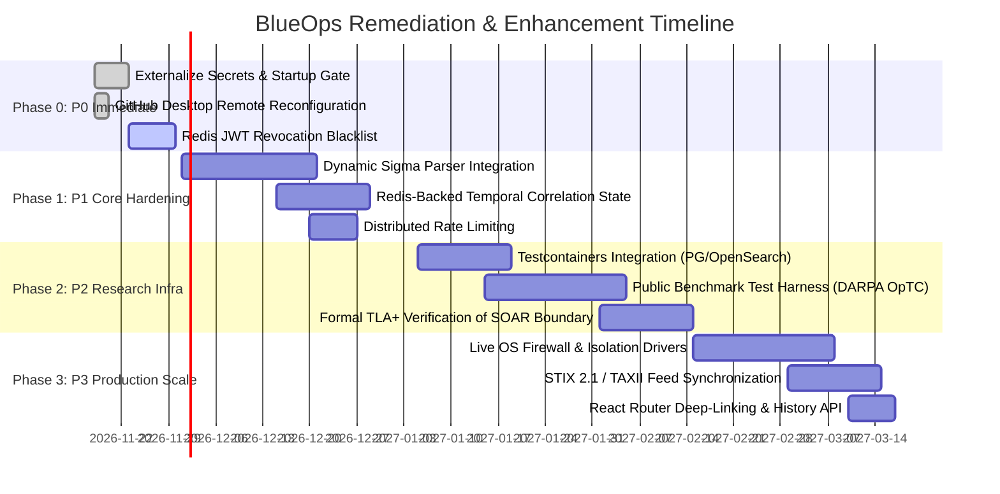

# BLUEOPS TECHNICAL AUDIT: REMEDIATION ROADMAP
**Document ID:** BLUEOPS-AUDIT-ROAD-001  
**Scope:** Prioritized Technical Remediation Backlog, Implementation Guidance, and Engineering Effort Estimations  
**Target Codebase:** `blueops-defense-cloud`  
**Classification:** Technical Due Diligence & Engineering Planning  

---

## 1. Roadmap Phasing Strategy

The remediation items are organized into four sequential engineering phases:
* **Phase 0: Immediate Security Hardening & Repository Hygiene (P0 — Weeks 1–2)**
  * Critical vulnerabilities, secrets management, and source control linkage.
* **Phase 1: Core Engine Architecture & State Hardening (P1 — Months 1–2)**
  * Eliminating architectural technical debt, dynamic Sigma parsing, and persistent state.
* **Phase 2: Research Infrastructure & Empirical Benchmarking (P2 — Months 3–4)**
  * Testcontainers, comparative baselines, and formal verification for academic publication.
* **Phase 3: Enterprise Scalability & Production Readiness (P3 — Months 5–6)**
  * Real host OS response agent execution, STIX/TAXII integration, and deep URL routing.

---

## 2. Prioritized Engineering Backlog



---

### PHASE 0: IMMEDIATE HARDENING (P0 — Weeks 1–2)

#### REM-001: Externalize Hardcoded Secrets & Implement Startup Validation
* **Priority:** `P0 (CRITICAL)`
* **Vulnerability ID:** `VULN-001`
* **Architectural Justification:** Default static keys in `application.yml` and `agent.py` allow signature spoofing and token forging if deployed unchanged.
* **Effort:** 3 Engineering Days (3 Story Points)
* **Affected Files:**
  * `backend/src/main/resources/application.yml`
  * `backend/src/main/java/com/blueops/security/JwtTokenProvider.java`
  * `backend/src/main/java/com/blueops/response/HmacSignatureService.java`
  * `response-agent/src/agent.py`
* **Implementation Guidance:**
  * Implement a Spring `@PostConstruct` validation bean that checks `blueops.jwt.secret` and `blueops.response-agent.secret`. If the keys match default test strings, abort startup with an explicit `IllegalStateException("CRITICAL: Default secret detected in production profile")`.
  * Ensure `.env.example` contains placeholder tokens only.

#### REM-002: Resolve GitHub Desktop Remote Mismatch & Push Alignment
* **Priority:** `P0 (CRITICAL)`
* **Architectural Justification:** GitHub Desktop is attempting to push upstream to `https://github.com/hsk-27/BlueOps.git/`, which does not exist on GitHub, returning HTTP 404 (`fatal: repository not found`).
* **Effort:** 0.5 Engineering Days (1 Story Point)
* **Affected Files:** Local Git configuration (`.git/config`)
* **Implementation Guidance:**
  * Step 1: Create an empty repository named `blueops-defense-cloud` (or `BlueOps`) on GitHub web (`https://github.com/new`).
  * Step 2: Set the correct remote URL via shell:
    ```powershell
    git remote remove origin
    git remote add origin https://github.com/hsk-27/blueops-defense-cloud.git
    git push -u origin main
    ```
  * In GitHub Desktop: Go to `Repository -> Repository Settings -> Remote` and ensure the Primary remote URL matches the created repository.

#### REM-003: Implement Redis-Backed JWT Revocation Blacklist
* **Priority:** `P0 (CRITICAL)`
* **Vulnerability ID:** `VULN-002`
* **Architectural Justification:** Stateless JWT logout currently does not invalidate the token, leaving an active 15-minute attack window if a token is intercepted.
* **Effort:** 5 Engineering Days (5 Story Points)
* **Affected Files:**
  * `backend/src/main/java/com/blueops/security/JwtAuthenticationFilter.java`
  * `backend/src/main/java/com/blueops/auth/AuthService.java`
  * `docker-compose.yml` (add `redis:7-alpine`)
* **Implementation Guidance:**
  * Add a Redis service to Docker Compose.
  * In `AuthService.logout()`, extract the JWT ID (`jti`) and token expiry, and store `blacklisted_tokens:{jti}` with TTL equal to the remaining expiration time.
  * In `JwtAuthenticationFilter`, check Redis before authenticating the request.

---

### PHASE 1: CORE ENGINE ARCHITECTURE HARDENING (P1 — Months 1–2)

#### REM-004: Dynamic Sigma Rule Parser Integration
* **Priority:** `P1 (HIGH)`
* **Technical Debt ID:** `DEBT-001`
* **Architectural Justification:** The project has 18 declarative Sigma YAML files, but the Java engine uses hardcoded regexes. Adding new rules currently requires recompilation.
* **Effort:** 15 Engineering Days (13 Story Points)
* **Affected Files:**
  * `backend/src/main/java/com/blueops/detections/DetectionRuleService.java`
  * `backend/src/main/java/com/blueops/telemetry/DetectionEvaluationService.java`
  * `backend/pom.xml` (Add `snakeyaml` or `sigma-parser-java`)
* **Implementation Guidance:**
  * Implement a YAML Sigma loader that parses rule definitions into an Abstract Syntax Tree (AST) at application startup and on-demand via `POST /api/v1/detections/reload`.
  * Compile AST conditions into compiled predicate filters against `NormalizedEvent` fields.

#### REM-005: Redis-Backed Sliding Temporal Correlation State
* **Priority:** `P1 (HIGH)`
* **Technical Debt ID:** `DEBT-002`
* **Architectural Justification:** Restarting the backend flushes in-flight correlation windows. Multi-instance scaling is impossible without shared state.
* **Effort:** 10 Engineering Days (8 Story Points)
* **Affected Files:**
  * `backend/src/main/java/com/blueops/detections/correlation/CorrelationEngine.java`
* **Implementation Guidance:**
  * Store finding timestamps and rule codes in Redis Sorted Sets (`ZADD`) keyed by `asset_id:{assetId}:findings`.
  * Score entries by epoch millisecond. Use `ZREMRANGEBYSCORE` to evict entries older than the 24-hour correlation horizon automatically.

---

### PHASE 2: RESEARCH & VERIFICATION INFRASTRUCTURE (P2 — Months 3–4)

#### REM-006: Testcontainers Integration for True Integration Testing
* **Priority:** `P2 (MEDIUM)`
* **Technical Debt ID:** `DEBT-003`
* **Architectural Justification:** H2 does not replicate PostgreSQL index performance, JSONB column operations, or OpenSearch cluster timeouts.
* **Effort:** 7 Engineering Days (5 Story Points)
* **Affected Files:**
  * `backend/pom.xml` (`org.testcontainers:postgresql`, `org.testcontainers:junit-jupiter`)
  * `backend/src/test/java/com/blueops/BaseIntegrationTest.java`
* **Implementation Guidance:**
  * Establish a base test class spinning up ephemeral `PostgreSQLContainer("postgres:16-alpine")`.
  * Verify Flyway migrations and JSONB queries under real PostgreSQL conditions.

#### REM-007: Public Benchmark Harness (DARPA OpTC & Atomic Red Team)
* **Priority:** `P2 (MEDIUM)`
* **Architectural Justification:** Required for empirical evaluation in academic paper submissions.
* **Effort:** 12 Engineering Days (8 Story Points)
* **Affected Files:**
  * `test-lab/adversary-simulation/`
  * `test-lab/run_simulations.js`
* **Implementation Guidance:**
  * Build an automated parser for the DARPA Transparent Computing (OpTC) JSON logs.
  * Stream OpTC events through the BlueOps ingestion endpoint and compute ROC curves, Precision-Recall AUC, and detection latency against Wazuh and Elastic baselines.

---

### PHASE 3: PRODUCTION SCALABILITY (P3 — Months 5–6)

#### REM-008: Real Host OS Firewall & Process Remediation Drivers
* **Priority:** `P3 (MEDIUM)`
* **Architectural Justification:** The response agent currently executes in `LAB_CONTROLLED_EXECUTION` mode without applying actual OS remediation.
* **Effort:** 15 Engineering Days (13 Story Points)
* **Affected Files:**
  * `response-agent/src/agent.py`
  * `response-agent/src/drivers/linux_iptables.py`
  * `response-agent/src/drivers/windows_netsh.py`
* **Implementation Guidance:**
  * Implement modular OS execution drivers:
    * Linux: `nftables` or `iptables -I INPUT -s {target} -j DROP`
    * Windows: `New-NetFirewallRule -Direction Inbound -RemoteAddress {target} -Action Block`
  * Run the agent as a dedicated unprivileged user with strictly scoped `sudoers` rules for firewall binaries only.

#### REM-009: Client-Side Deep Linking via React Router
* **Priority:** `P3 (LOW)`
* **Technical Debt ID:** `DEBT-004`
* **Architectural Justification:** Enables shareable URLs for incidents, detections, and timeline notes.
* **Effort:** 4 Engineering Days (3 Story Points)
* **Affected Files:**
  * `frontend/package.json` (add `react-router-dom`)
  * `frontend/src/App.tsx`
* **Implementation Guidance:**
  * Wrap `App.tsx` with `BrowserRouter`.
  * Map routes: `/incidents/:id`, `/detections/:ruleCode`, `/telemetry`, `/threat-intel`.
