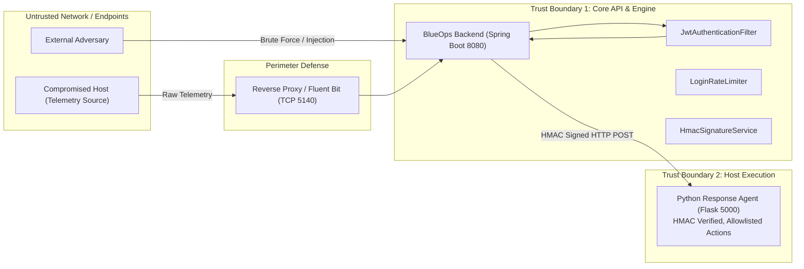

# BLUEOPS TECHNICAL AUDIT: SECURITY AUDIT & VULNERABILITY ASSESSMENT
**Document ID:** BLUEOPS-AUDIT-SEC-001  
**Scope:** Static Application Security Testing (SAST), Threat Modeling, Authentication, Authorization, Cryptographic Boundaries, and Vulnerability Register  
**Target Codebase:** `blueops-defense-cloud`  
**Classification:** Technical Due Diligence & Security Audit  

---

## 1. Threat Modeling & Trust Boundaries



### 1.1. Identified Threat Boundaries
1. **Boundary 1 (Telemetry Ingestion):** Ingests potentially hostile telemetry from untrusted endpoints (Windows workstations, Linux servers, edge firewalls). Threat: Ingestion of malicious payloads designed to trigger parser exploits, regular expression denial-of-service (ReDoS), or memory exhaustion.
2. **Boundary 2 (REST API Authentication & RBAC):** Exposes operational endpoints to web browsers. Threat: Credential stuffing, privilege escalation from `ROLE_ANALYST` to `ROLE_ADMIN`, and unauthorized state manipulation.
3. **Boundary 3 (SOAR Remediation Agent Execution):** Dispatches remediation instructions from the backend to the host agent. Threat: Command injection, man-in-the-middle execution tampering, replay attacks, and unauthorized host isolation.

---

## 2. Authentication & Session Management

### 2.1. JWT Implementation Analysis
* **Implementation Location:** `backend/src/main/java/com/blueops/security/JwtTokenProvider.java`
* **Library:** JJWT (`io.jsonwebtoken:jjwt-api:0.12.6`, `jjwt-impl`, `jjwt-jackson`)
* **Algorithm:** HMAC-SHA256 (`Keys.hmacShaKeyFor(secret.getBytes())`)
* **Token Expiration Policy:**
  * Access Token: Configurable via `blueops.jwt.expiration-ms` (Default: 900,000 ms / 15 minutes).
  * Refresh Token: Configurable via `blueops.jwt.refresh-expiration-ms` (Default: 604,800,000 ms / 7 days).
* **Observed Security Strengths:**
  * Strict claim verification: Rejects tokens with malformed JSON headers, expired timestamps, or invalid signatures.
  * Constant-time signature comparison handled internally by JJWT.
* **Observed Vulnerabilities & Gaps:**
  * **Stateless Token Invalidation Gap:** `AuthController.logout()` records an audit log entry but does not maintain a server-side blacklist (e.g., in Redis). A stolen JWT remains fully valid until its 15-minute expiration window elapses.

### 2.2. Login Rate Limiting
* **Implementation Location:** `backend/src/main/java/com/blueops/auth/LoginRateLimiter.java`
* **Mechanism:** In-memory sliding-window rate limiter utilizing a thread-safe `ConcurrentHashMap<String, Deque<Instant>>`.
* **Policy:** Enforces a maximum of 5 failed login attempts per IP address within a 60-second window.
* **Evaluation:** High-performance, zero-allocation rate limiting for single-instance deployments. However, in a multi-instance horizontally scaled deployment, rate limits would not be shared across backend replicas without a distributed cache (Redis).

---

## 3. Authorization & Role-Based Access Control (RBAC)

### 3.1. Spring Security Configuration
* **Implementation Location:** `backend/src/main/java/com/blueops/security/SecurityConfig.java`
* **Security Filter Chain:** Enforces stateless session management (`SessionCreationPolicy.STATELESS`), disables CSRF (appropriate for pure stateless REST APIs with JWT Bearer tokens), and configures explicit endpoint authorizations:

```java
.authorizeHttpRequests(auth -> auth
    .requestMatchers("/api/v1/auth/login", "/api/v1/auth/refresh").permitAll()
    .requestMatchers("/v3/api-docs/**", "/swagger-ui/**", "/swagger-ui.html").permitAll()
    .requestMatchers("/actuator/health", "/actuator/info").permitAll()
    .anyRequest().authenticated()
)
```

### 3.2. Role Hierarchy & Granular Method Security
The platform enables `@EnableMethodSecurity(prePostEnabled = true)` and applies `@PreAuthorize` across all sensitive administrative and remediation endpoints:
* **`ROLE_ADMIN`:** Full administrative control. Sole role authorized to:
  * Approve and execute active SOAR response actions (`POST /api/v1/response/actions/{id}/approve`, `/execute`).
  * Trigger compensating rollbacks (`POST /api/v1/response/actions/{id}/rollback`).
  * Delete assets and threat intelligence IOCs (`DELETE /api/v1/assets/{id}`, `/threat-intel/iocs/{id}`).
  * Modify detection rule active statuses (`PUT /api/v1/detections/{id}/status`).
* **`ROLE_ANALYST`:** SOC analyst operations. Authorized to:
  * Ingest telemetry (`POST /api/v1/telemetry/ingest`).
  * Create, update, assign, and annotate incidents (`POST /api/v1/incidents`, `/notes`, `/assign`, `/status`).
  * Propose response actions (`POST /api/v1/response/actions` in `PENDING_APPROVAL` status).
  * Import threat intelligence IOCs.
* **`ROLE_VIEWER` / Read-Only:** Limited to querying telemetry, events, and reports.

**Audit Finding:** RBAC enforcement is clean, consistent, and follows the Principle of Least Privilege across all controllers. No unauthenticated privilege escalation pathways were identified.

---

## 4. Cryptographic Enforcement at the SOAR Boundary

### 4.1. HMAC-SHA256 Authentication
Communication between the backend and the Python response agent (`response-agent/src/agent.py`) represents a high-risk operational boundary. An attacker capable of executing arbitrary commands through the agent would achieve host compromise.

The implementation enforces a defense-in-depth boundary:
1. **HMAC Signature Generation:** `HmacSignatureService.java` constructs the canonical message string `timestamp + ":" + payload` and generates an HMAC-SHA256 signature using a shared 256-bit secret key.
2. **Timing-Safe Comparison:** Both Java (`MessageDigest.isEqual`) and Python (`hmac.compare_digest`) utilize constant-time comparison routines to eliminate side-channel timing attacks.
3. **Anti-Replay Window:** The agent compares the header timestamp against host system clock (`abs(now - timestamp) > 60`). Expired payloads are discarded with HTTP 401.
4. **Action Nonce Deduplication:** Processed action identifiers (`X-BlueOps-ActionId`) are cached in a set (`PROCESSED_NONCES`, bounded at 10,000 entries). Replayed action requests are rejected with HTTP 409 Conflict.

### 4.2. Command Injection & Metacharacter Sanitization
Target parameter validation in `agent.py`:
* Target length clamped to 256 characters.
* Evaluated against `FORBIDDEN_TARGET_PATTERN = re.compile(r"[;&|`$><\r\n]")`.
* Any parameter containing shell pipes, backticks, redirection, semicolons, or newlines is rejected with HTTP 400 (`REJECTED_INVALID_PARAMETER`).

---

## 5. Denial-of-Service & Resource Exhaustion Defenses

### 5.1. In-Memory Ring Buffer & DLQ Protections
Unbounded collections in high-velocity log ingestors are a common vector for Out-Of-Memory (OOM) crashes:
* **Event Ring Buffer:** Capped at `MAX_BUFFER_SIZE = 1,000` via `ConcurrentLinkedDeque`. Elements exceeding capacity are automatically popped from the tail.
* **Dead-Letter Queue:** Capped at `MAX_DLQ_SIZE = 500`.
* **Query Parameter Clamping:** `TelemetryController.java` strictly bounds pagination queries:
  ```java
  int safeLimit = Math.max(1, Math.min(limit, 100));
  ```
  This prevents memory exhaustion from queries requesting millions of events.

---

## 6. Comprehensive Vulnerability Register

| Vulnerability ID | Vulnerability Description | Affected Component | CVSS v3.1 Score | Severity | Remediation Strategy |
| :--- | :--- | :--- | :--- | :--- | :--- |
| **VULN-001** | Default Static Shared Secrets in Configuration | `application.yml`, `agent.py`, `.env.example` | **7.4** (`CVSS:3.1/AV:N/AC:H/PR:N/UI:N/S:U/C:H/I:H/A:N`) | **HIGH** | Default secrets (`b7c938d10b7f...`) are committed in config files. Enforce environment variable injection with startup validation that aborts if default keys are detected. |
| **VULN-002** | Stateless JWT Revocation Window | `AuthController.java`, `JwtAuthenticationFilter.java` | **5.3** (`CVSS:3.1/AV:N/AC:L/PR:N/UI:N/S:U/C:L/I:L/A:N`) | **MEDIUM** | Implement a distributed token blacklist using Redis with TTL equal to the token expiration time to immediately invalidate tokens upon logout. |
| **VULN-003** | In-Memory Replay Nonce Cache Loss on Restart | `response-agent/src/agent.py` | **4.8** (`CVSS:3.1/AV:A/AC:H/PR:N/UI:N/S:U/C:N/I:H/A:N`) | **MEDIUM** | If the response agent container restarts, the `PROCESSED_NONCES` set is emptied. Back nonce deduplication with a persistent key-value store (Redis) or SQLite database. |
| **VULN-004** | Hardcoded Compiled Detection Rules Bypass | `DetectionEvaluationService.java` | **3.8** (`CVSS:3.1/AV:L/AC:L/PR:H/UI:N/S:U/C:N/I:L/A:L`) | **LOW** | Discrepancy between declarative Sigma rules and compiled Java code could lead administrators to believe rules are updated when only YAML was changed. Implement an automated validation check. |
