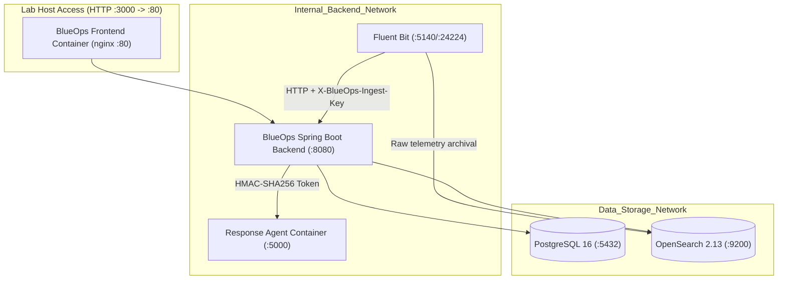

# BlueOps Deployment & Production Hardening Guide (M7)

**Document ID:** BLUEOPS-DOC-M7-003  
**Milestone:** M7 Operational Hardening & Reliability  
**Classification:** Infrastructure Architecture & Deployment Standard  

---

## 1. System Requirements & Prerequisites

BlueOps is architected as a modular, container-ready defensive cybersecurity platform.

### 1.1 Minimum Hardware Specifications
- **Evaluation / Lab Node:**
  - 4 vCPUs (x86_64 or ARM64)
  - 8 GB RAM
  - 50 GB SSD storage
- **Production SOC Deployment (Up to 10k eps):**
  - 8–16 vCPUs
  - 32 GB RAM (16 GB dedicated to OpenSearch/JVM heap)
  - 500 GB NVMe storage (RAID-10 recommended for PostgreSQL WAL)

### 1.2 Software Dependencies
- **Containerized:** Docker 24.0+ and Docker Compose v2.20+
- **Bare-Metal:**
  - Eclipse Temurin OpenJDK 21 LTS
  - Node.js 20 LTS
  - PostgreSQL 16+
  - OpenSearch 2.13+
  - Python 3.11+ (for optional isolated Response Agents)

---

## 2. Lab / Demonstration Docker Compose Topology

> **IMPORTANT SECURITY NOTICE:** The repository's root `docker-compose.yml` is a **lab / demonstration** topology only. It exposes plain HTTP (`:80` via `frontend/nginx.conf`), runs single-node OpenSearch with `DISABLE_SECURITY_PLUGIN=true`, and must **not** be exposed directly to untrusted networks without an external TLS reverse proxy and strong `.env` secrets.



### 2.1 Reference Production `docker-compose` Example
The snippet below illustrates how a hardened operator-managed deployment adds required secret guards (`:?`), Nginx TLS termination (Section 4.2), and non-default keys — the root `docker-compose.yml` itself remains lab/demo-scoped:

```yaml
version: '3.8'

services:
  postgres:
    image: postgres:16-alpine
    container_name: blueops-postgres
    restart: always
    environment:
      POSTGRES_DB: ${POSTGRES_DB:-blueops}
      POSTGRES_USER: ${POSTGRES_USER:-blueops}
      POSTGRES_PASSWORD: ${POSTGRES_PASSWORD:?Required}
    volumes:
      - postgres_data:/var/lib/postgresql/data
    networks:
      - blueops-internal
    healthcheck:
      test: ["CMD-SHELL", "pg_isready -U $$POSTGRES_USER -d $$POSTGRES_DB"]
      interval: 10s
      timeout: 5s
      retries: 5

  opensearch:
    image: opensearchproject/opensearch:2.13.0
    container_name: blueops-opensearch
    restart: always
    environment:
      - cluster.name=blueops-cluster
      - node.name=blueops-node-1
      - discovery.type=single-node
      - bootstrap.memory_lock=true
      - "OPENSEARCH_JAVA_OPTS=-Xms2g -Xmx2g"
      - DISABLE_SECURITY_PLUGIN=true
    ulimits:
      memlock:
        soft: -1
        hard: -1
      nofile:
        soft: 65536
        hard: 65536
    volumes:
      - opensearch_data:/usr/share/opensearch/data
    networks:
      - blueops-internal

  backend:
    build:
      context: ./backend
      dockerfile: Dockerfile
    container_name: blueops-backend
    restart: always
    depends_on:
      postgres:
        condition: service_healthy
    environment:
      SPRING_PROFILES_ACTIVE: prod
      SERVER_PORT: 8080
      SPRING_DATASOURCE_URL: jdbc:postgresql://postgres:5432/${POSTGRES_DB:-blueops}
      SPRING_DATASOURCE_USERNAME: ${POSTGRES_USER:-blueops}
      SPRING_DATASOURCE_PASSWORD: ${POSTGRES_PASSWORD:?Required}
      JWT_SECRET: ${JWT_SECRET:?RequiredStrongKeyAtLeast32Bytes}
      BLUEOPS_OPENSEARCH_URI: http://opensearch:9200
      RESPONSE_AGENT_URL: http://response-agent:5000
      RESPONSE_AGENT_SECRET: ${RESPONSE_AGENT_SECRET:?RequiredHmacSecret}
      RESPONSE_AGENT_SIMULATION_MODE: "true"
    networks:
      - blueops-internal
    healthcheck:
      test: ["CMD-SHELL", "wget -q --spider http://localhost:8080/actuator/health || exit 1"]
      interval: 15s
      timeout: 5s
      retries: 3

  frontend:
    build:
      context: ./frontend
      dockerfile: Dockerfile
    container_name: blueops-frontend
    restart: always
    ports:
      - "80:80"
    depends_on:
      - backend
    networks:
      - blueops-internal

  response-agent:
    build:
      context: ./response-agent
      dockerfile: Dockerfile
    container_name: blueops-response-agent
    restart: always
    environment:
      RESPONSE_AGENT_SECRET: ${RESPONSE_AGENT_SECRET:?RequiredHmacSecret}
      EXECUTION_MODE: SIMULATION
      ALLOW_LIVE_HOST_DISRUPTION: "false"
    networks:
      - blueops-internal

networks:
  blueops-internal:
    driver: bridge

volumes:
  postgres_data:
  opensearch_data:
```

---

## 3. Environment Variables & Secrets Reference

All parameters can be securely configured using environment variables. Hardcoded secrets are explicitly rejected by `SecurityStartupValidator` when running under `prod` profiles.

| Environment Variable | Default Value | Description | Security / Deployment Guidance |
| :--- | :--- | :--- | :--- |
| `SPRING_PROFILES_ACTIVE` | `dev` | Active Spring profile (`dev`, `prod`, `test`) | Use `dev` locally (H2); `prod` enforces non-default secrets |
| `SERVER_PORT` | `8080` | Backend HTTP port | Internal container port |
| `JWT_SECRET` | *(dev fallback only)* | 256-bit secret used for signing JWT tokens | **Mandatory CSPRNG key** (>= 32 bytes, high entropy) in `prod` |
| `JWT_EXPIRATION_MS` | `3600000` | Access token lifespan (1 hour) | Recommended: 3600000 (1h) |
| `BLUEOPS_INGEST_API_KEY` | *(empty — fail closed)* | API key for Fluent Bit `POST /api/v1/telemetry/ingest` | Set matching key in `backend` and `fluent-bit` containers |
| `BLUEOPS_DEMO_SEED_FINDINGS` | `false` | Optional demo finding seed toggle | Keep `false` so operational store starts empty |
| `SPRING_DATASOURCE_URL` | `jdbc:postgresql://localhost:5432/blueops_db` | PostgreSQL JDBC connection URL | Point to PostgreSQL instance |
| `SPRING_DATASOURCE_USERNAME` | `blueops_user` | Database username | Least-privilege account |
| `SPRING_DATASOURCE_PASSWORD` | *(required in prod)* | Database user password | **Strong random password required** |
| `BLUEOPS_OPENSEARCH_URI` | `http://localhost:9200` | OpenSearch REST URI | HTTP/HTTPS endpoint |
| `BLUEOPS_OPENSEARCH_ENABLED` | `true` (`false` in `dev`) | Enable remote OpenSearch indexing | Fallback in-memory active if disabled/unreachable |
| `RESPONSE_AGENT_URL` | `http://localhost:5000` | Python response agent base URL | Set to `http://response-agent:5000` in Compose |
| `RESPONSE_AGENT_SECRET` | *(dev fallback only)* | Shared HMAC-SHA256 secret (backend + Python agent) | **Mandatory strong 256-bit secret** in `prod` |
| `RESPONSE_AGENT_SIMULATION_MODE` | `true` | Enforces safe `SIMULATION` mode in agent & reporting | **Keep `true`; see `AGENTS.md` AI/Operator Safety Guard** |
| `BLUEOPS_ALLOW_LIVE_EXECUTION` | `false` | Backend SOAR & legacy response live-dispatch guard | **Keep `false` unless running in non-laptop isolated sandbox** |
| `EXECUTION_MODE` | `SIMULATION` | Agent driver selection label (`SIMULATION` or hypothetical platform driver) | `drivers.py` executes hypothetically with zero OS subprocesses |
| `BLUEOPS_ALLOW_LIVE_HOST_DISRUPTION` | `false` | Legacy host-protection flag (ignored; OS commands removed from `drivers.py`) | **Keep `false` and do not re-introduce host OS mutations** |

---

## 4. Single-Node / Bare-Metal Production Deployment

For air-gapped or dedicated hardware installations:

### 4.1 Systemd Unit File (`/etc/systemd/system/blueops-backend.service`)
```ini
[Unit]
Description=BlueOps Defensive Cybersecurity Backend
After=network.target postgresql.service opensearch.service
Wants=postgresql.service

[Service]
Type=simple
User=blueops
Group=blueops
WorkingDirectory=/opt/blueops/backend
EnvironmentFile=/etc/blueops/backend.env
ExecStart=/usr/bin/java \
    -XX:+UseG1GC \
    -XX:MaxRAMPercentage=75.0 \
    -Dspring.profiles.active=prod \
    -jar /opt/blueops/backend/blueops-backend.jar
Restart=always
RestartSec=10
LimitNOFILE=65536

# Security Hardening
ProtectSystem=strict
ProtectHome=true
PrivateTmp=true
NoNewPrivileges=true
ReadWritePaths=/opt/blueops/backend/logs

[Install]
WantedBy=multi-user.target
```

### 4.2 Reverse Proxy Hardening (Nginx)
```nginx
server {
    listen 443 ssl http2;
    server_name soc.blueops.internal;

    ssl_certificate /etc/ssl/certs/blueops.crt;
    ssl_certificate_key /etc/ssl/private/blueops.key;
    ssl_protocols TLSv1.2 TLSv1.3;
    ssl_ciphers HIGH:!aNULL:!MD5;

    # Security Headers
    add_header X-Frame-Options "DENY" always;
    add_header X-Content-Type-Options "nosniff" always;
    add_header Content-Security-Policy "default-src 'self'; script-src 'self'; style-src 'self' 'unsafe-inline';" always;

    location / {
        root /opt/blueops/frontend/dist;
        index index.html;
        try_files $uri $uri/ /index.html;
    }

    location /api/ {
        proxy_pass http://127.0.0.1:8080/api/;
        proxy_set_header Host $host;
        proxy_set_header X-Real-IP $remote_addr;
        proxy_set_header X-Forwarded-For $proxy_add_x_forwarded_for;
        proxy_set_header X-Forwarded-Proto $scheme;
    }

    location /actuator/health {
        proxy_pass http://127.0.0.1:8080/actuator/health;
        allow 10.0.0.0/8;
        deny all;
    }
}
```

---

## 5. Verification Checklist Post-Deployment
1. Verify database migrations: Inspect table count (`\dt` in PostgreSQL returns 16 core tables).
2. Query `/api/v1/system/health`: Verify HTTP 200 `status: UP`.
3. Ingest test heartbeat telemetry: Verify `HTTP 200` and `normalized: 1`.
4. Check SOAR safety latch: Run pre-flight preview for `P001`; confirm containment policy outcome is evaluated.
