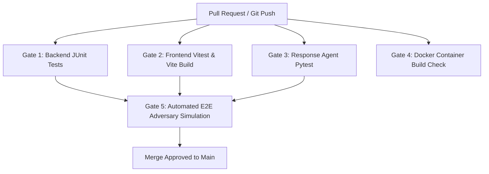

# BLUEOPS TESTING STRATEGY & VERIFICATION ARCHITECTURE

**Document Version:** 2.0.0  
**Classification:** Quality Assurance, Test Architecture & Verification Standards  
**System Document ID:** BLUEOPS-TEST-2026-001  

---

## 1. TESTING PHILOSOPHY: EVIDENCE OVER CLAIMS

In accordance with **Architectural Invariant 10** (*No unsubstantiated claims*), BlueOps enforces an uncompromising testing discipline:

1. **Reproducibility:** Every detection claim, benchmark result, and performance statistic must be reproducible via automated test suites in `test-lab/` or unit/integration test harnesses.
2. **False-Positive Guardrails:** A detection rule is not verified merely because it detects an attack; it must simultaneously demonstrate that it does not fire on normal, benign enterprise background noise.
3. **Fail-Closed Verification:** Security mechanisms (HMAC validation, replay defense, startup entropy checks, policy validation) must be tested against intentional attack payloads (tampered headers, expired nonces, malicious loopback targets).

---

## 2. THE BLUEOPS TESTING PYRAMID

```
                        ▲
                       / \
                      /   \  Tier 5: Adversarial & Boundary Testing
                     / Tier\ (Deceptive Attack Suite, Replay, Fuzzing)
                    /   4   \ Tier 4: End-to-End Spine Verification
                   /---------\ (16-Step MV-OL Automated Scenarios)
                  /  Tier 3   \ Tier 3: Subsystem Contract Testing
                 /-------------\ (CES Normalization, Sigma AST Syntax)
                /    Tier 2     \ Tier 2: Component Integration Testing
               /-----------------\ (Spring Boot Slices, JPA, WebMvc)
              /      Tier 1       \ Tier 1: Unit Tests & Static Analysis
             /─────────────────────\ (JUnit 5, Mockito, Vitest, Pytest)
```

### Tier 1: Unit Tests & Static Analysis
- **Backend:** JUnit 5 + Mockito testing core domain logic (`LoginRateLimiterTest`, `JwtTokenProviderTest`, `SigmaFieldMatcherTest`, `SigmaConditionEvaluatorTest`, `SigmaAggregationEngineTest`, `IncidentLifecycleAndWorkflowTest`). Currently **78 tests passing** (0 failures, 0 errors).
- **End-to-End Integration:** Deterministic 17-step operational lifecycle test (`EndToEndAnalystWorkflowIntegrationTest`) validating telemetry ingestion through finding correlation, incident creation, evidence inspection, and formal closure.
- **Response Agent:** Pytest testing FastAPI routing, signature calculation, and OS driver commands.
- **Frontend:** Vitest + React Testing Library testing badge rendering, auth context, and advisor UI components. Currently **6 tests passing**.
- **Static Analysis:** TypeScript compilation (`tsc --noEmit`), Vite production build verification.

### Tier 2: Component Integration Testing
- **Persistence Layer:** `@DataJpaTest` validating PostgreSQL schema integrity, foreign key cascades, and Flyway migration execution.
- **REST Controller Slices:** `@WebMvcTest` with Spring Security test context verifying role authorization (`ROLE_ADMIN` vs `ROLE_ANALYST` vs `ROLE_VIEWER`).
- **Resilience Slices:** Testing `OpenSearchFindingAdapter` fallback to local memory when remote OpenSearch times out.

### Tier 3: Subsystem Contract Testing
- Validates that normalized events emitted by `EventNormalizationService` strictly conform to `NormalizedEvent` (CES v1.0.0) field types.
- Verifies that all 18 YAML Sigma rules in `detection-rules/sigma/` parse without error and produce valid Boolean ASTs.

### Tier 4: End-to-End Spine Lifecycle Verification
- **Automated Adversary Simulator (`test-lab/run_simulations.js`):**
  - Ingests 10 multi-stage synthetic attack sequences covering D001–D018 and C001–C002.
  - Ingests 50 benign baseline background events (normal web browsing, scheduled maintenance, standard user logins).
  - Asserts that all 10 attacks generate corresponding findings and incidents.
  - Asserts that all 50 benign streams produce zero findings (**0.00% False Positive Rate on curated baseline**).

### Tier 5: Adversarial & Boundary Testing
- **Deceptive Attack Suite (`test-lab/adversary-simulation/deceptive_attack_suite.js`):**
  - **Replay Attack:** Submits identical signed payload twice $\rightarrow$ Expects HTTP 409 Conflict.
  - **Signature Tampering:** Modifies single byte in payload body $\rightarrow$ Expects HTTP 401 Unauthorized.
  - **Expired Timestamp:** Sends request with timestamp 120s in the past $\rightarrow$ Expects HTTP 401 Unauthorized.
  - **Loopback Injection:** Submits action targeting `127.0.0.1` $\rightarrow$ Expects HTTP 400 Policy Violation.
  - **Gateway Injection:** Submits action targeting default gateway $\rightarrow$ Expects HTTP 400 Policy Violation.

---

## 3. TEST EXECUTION COMMAND REFERENCE

All tests must be executable with standard toolchains without requiring internet connectivity:

### 1. Execute All Backend Unit & Integration Tests (JUnit 5)
```powershell
cd backend
.\mvnw.cmd test
```
*Expected Result:* `Tests run: 60, Failures: 0, Errors: 0, Skipped: 0` (Execution time: ~30s).

### 2. Execute All Frontend Tests & Production Build (Vitest & Vite)
```powershell
cd frontend
npm test
npm run build
```
*Expected Result:* `6 passed (6)` Vitest suites; `tsc && vite build` completes with 0 errors.

### 3. Execute Response Agent Test Suite (Pytest)
```powershell
cd response-agent
pytest tests/ -v
```

### 4. Execute End-to-End Adversary & Benign Telemetry Simulations
```powershell
cd test-lab
node run_simulations.js
```
*Expected Result:* 10/10 adversary scenarios detected, 50/50 benign events negative.

### 5. Execute Adversarial Boundary & Replay Verification
```powershell
cd test-lab/adversary-simulation
node deceptive_attack_suite.js
```
*Expected Result:* 5/5 boundary security tests passed.

---

## 4. CONTINUOUS INTEGRATION (CI) QUALITY GATES

BlueOps maintains GitHub Actions workflows in `.github/workflows/ci.yml`:



### Blocking Conditions for CI:
1. Any JUnit or Vitest test failure.
2. Any TypeScript type error during `vite build`.
3. Any failure in the adversary simulation or deceptive attack suite.
4. Any failure in Docker image container builds (`backend/Dockerfile`, `frontend/Dockerfile`, `response-agent/Dockerfile`).
