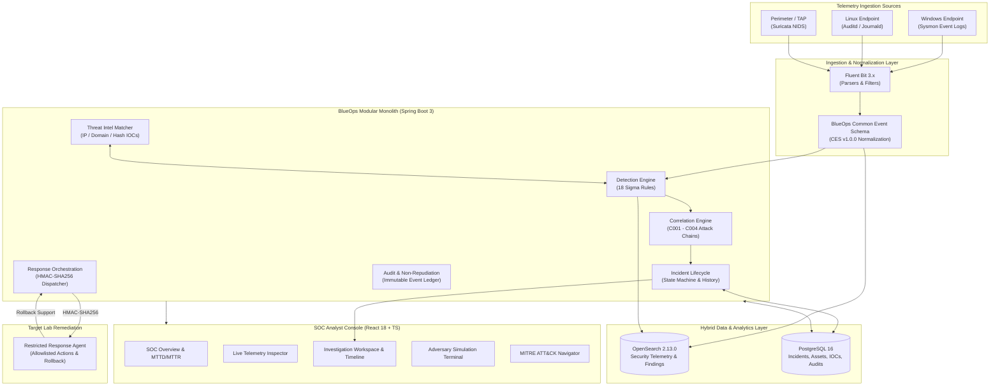

<p align="center">
  
</p>

<h1 align="center">BlueOps — Enterprise Threat Detection & Automated Incident Response Platform</h1>

<p align="center">
  <strong>A deployable, deterministic miniature Security Operations Center (SOC) platform engineered for enterprise telemetry ingestion, Sigma detection rules, multi-stage attack correlation, threat intelligence enrichment, and cryptographically verified, reversible incident response.</strong>
</p>

<p align="center">
  <a href="https://github.com/your-org/blueops/actions"></a>
  <a href="https://github.com/your-org/blueops/security/advisories"></a>
  <a href="https://spring.io/projects/spring-boot"></a>
  <a href="https://react.dev"></a>
  <a href="https://csrc.nist.gov/pubs/sp/800/61/r2/final"></a>
  <a href="https://opensearch.org"></a>
  <a href="https://attack.mitre.org"></a>
  <a href="LICENSE"></a>
</p>

---

## Table of Contents

- [Overview & Objectives](#overview--objectives)
- [System Architecture](#system-architecture)
- [Key Engineering Capabilities](#key-engineering-capabilities)
- [Authoritative Incident Advisory System (AAS)](#authoritative-incident-advisory-system-aas)
- [Detection Engine & Correlation Matrix](#detection-engine--correlation-matrix)
- [Empirical Research Benchmarks](#empirical-research-benchmarks)
- [Directory Layout](#directory-layout)
- [Quick Start Guide](#quick-start-guide)
- [Controlled Response Agent](#controlled-response-agent)
- [Testing & Validation](#testing--validation)
- [Documentation Index](#documentation-index)
- [Contributing & Security](#contributing--security)
- [License](#license)

---

## Overview & Objectives

Enterprise security operations centers struggle with disparate telemetry silos, alert fatigue, and dangerous unconstrained response scripts. BlueOps was engineered to solve these challenges with a **modular monolith architecture** that balances defensive rigor with low computational overhead (fully operational on a **16 GB RAM laptop profile**).

### Core Design Principles:
1. **Deterministic Security Engineering:** Grounded in observable telemetry, standard Sigma syntax, and MITRE ATT&CK. No probabilistic black-box decisions in the core detection loop.
2. **Standardized Telemetry Pipelines:** Native ingestion and normalization for Windows Sysmon, Linux audit subsystem, and Suricata NIDS into the Common Event Schema (v1.0.0).
3. **Multi-Stage Attack Correlation:** Sliding-window sequence correlation that elevates low-confidence signals into high-confidence incidents.
4. **Constrained & Reversible Response:** All automated response actions are strictly allowlisted, HMAC-SHA256 authenticated, anti-replay protected, and reversible via compensating rollbacks.
5. **Empirical Academic Rigor:** Formally benchmarked against Atomic Red Team attack simulations and benign enterprise workloads to compute real Precision, Recall, Specificity, FPR, MTTD, and MTTR.

---

## System Architecture



---

## Key Engineering Capabilities

- **Unified Normalization Pipeline:** Maps raw Sysmon XML, Linux auditd logs, and Suricata EVE JSON into standardized `NormalizedEvent` structures preserving timestamps, raw event IDs, and process ancestry.
- **MITRE ATT&CK Detection Catalog:** 18 production-ready Sigma rules covering Credential Access, Execution, Persistence, Privilege Escalation, Defense Evasion, and Command & Control.
- **Authoritative Incident Advisory System (AAS):** Recommends deterministic, audit-ready next steps grounded strictly in **NIST SP 800-61 Rev. 2**, **CISA Federal IR Playbooks**, **MITRE D3FEND**, and **SANS PICERL / RFC 3227** with one-click response playbook dispatch.
- **Stateful Attack Chain Correlation:** Evaluates multi-event sequences across a configurable 60-minute window, correlating brute-force attacks with interactive privilege escalation.
- **Bidirectional Threat Intelligence:** Ingests IP, Domain, URL, and SHA256 indicators with automated matching and historical auditing.
- **Incident State Machine:** Enforces valid lifecycle transitions (`NEW` $\to$ `TRIAGED` $\to$ `INVESTIGATING` $\to$ `CONTAINED` $\to$ `RESOLVED` $\to$ `CLOSED`) with status history auditing and forensic evidence linking.
- **Enterprise AppSec & DevSecOps:** Sliding-window authentication rate limiting (lockout on 5 consecutive failures), BCrypt hashing, JWT RBAC (`ROLE_ANALYST`, `ROLE_ADMIN`), and HTTP filter chain security.
- **Interactive SOC Analyst Console:** Dark-mode UI featuring live telemetry inspector with JSON drawer, adversary simulation triggers, incident reports export (Markdown/JSON), and MITRE matrix heatmaps.

---

## Authoritative Incident Advisory System (AAS)

To eliminate unverified LLM hallucinations and high-stakes SOC errors, BlueOps integrates a deterministic advisory engine that evaluates live incident state, severity, MITRE tactics/techniques, and entity context (hostnames, remote C2 IPs, compromised accounts) against authoritative frameworks:

```
+-----------------------------------------------------------------------------------------+
|                              AUTHORITATIVE SOURCES REPOSITORY                           |
+----------------------------+-----------------------------+------------------------------+
| NIST SP 800-61 Rev. 2      | CISA Federal IR Playbook    | MITRE D3FEND & ATT&CK        |
| - §3.2.6 Prioritization    | - §3.1 Host Containment     | - D3-NTF (Traffic Filtering) |
| - §3.3.1 Containment Strat | - §3.3 Perimeter Blocking   | - D3-PE (Process Eviction)   |
| - §3.3.2 Evidence Handling | - Non-repudiation logging   | - M1018 (Account Management) |
+----------------------------+-----------------------------+------------------------------+
                                          |
                                          v
+-----------------------------------------------------------------------------------------+
|                  BLUEOPS DYNAMIC CONTEXT EVALUATION & DISPATCH ENGINE                   |
|  - Injects target entities (IPs, Hostnames, Users) into deterministic playbooks         |
|  - Generates step-by-step Standard Operating Procedures (SOPs) for Tier-1/2 analysts    |
|  - Offers 1-Click Execution: Host Isolation (P001), Perimeter Blocking (P002), etc.    |
|  - Embeds authoritative citations into Markdown and JSON export reports                |
+-----------------------------------------------------------------------------------------+
```

*See full specification: [`docs/AUTHORITATIVE_ADVISORY_SYSTEM.md`](docs/AUTHORITATIVE_ADVISORY_SYSTEM.md).*

---

## Detection Engine & Correlation Matrix

### 18 Detection Rules (Sigma & MITRE ATT&CK)

| Code | Rule Title | Log Source | Severity | MITRE Tactic | Technique |
|:---:|---|:---:|:---:|---|:---:|
| **D001** | Repeated SSH Authentication Failures | `linux_auditd` | LOW | Credential Access | T1110.001 |
| **D002** | Successful SSH Login Following Repeated Failures | `linux_auditd` | MEDIUM | Initial Access | T1078 |
| **D003** | Sudo Execution Without Controlling TTY | `linux_auditd` | HIGH | Privilege Escalation | T1548.003 |
| **D004** | Interactive Root Shell Spawned From Sudo | `linux_auditd` | HIGH | Privilege Escalation | T1548.003 |
| **D005** | Creation of Unauthorized Local Account | `linux_auditd` | MEDIUM | Persistence | T1136.001 |
| **D006** | Linux Audit Subsystem Tampering (`auditctl -D`) | `linux_auditd` | HIGH | Defense Evasion | T1562.001 |
| **D007** | Suspicious Systemd Unit Creation in `/etc/systemd/system` | `linux_auditd` | MEDIUM | Persistence | T1543.002 |
| **D008** | Obfuscated Encoded PowerShell Execution | `windows_sysmon` | HIGH | Execution | T1059.001 |
| **D009** | Office Application Spawning Command Shell | `windows_sysmon` | HIGH | Execution | T1059 |
| **D010** | Scheduled Task Persistence via Command Line | `windows_sysmon` | MEDIUM | Persistence | T1053.005 |
| **D011** | LSASS Memory Dumping via Comsvcs MiniDump | `windows_sysmon` | CRITICAL | Credential Access | T1003.001 |
| **D012** | Unexpected Kernel Driver Loading Activity | `windows_sysmon` | HIGH | Persistence | T1543.003 |
| **D013** | Security Event Log Clearing via `wevtutil cl` | `windows_sysmon` | CRITICAL | Defense Evasion | T1070.001 |
| **D014** | Outbound Network Connection to Non-Standard High Port | `suricata` | MEDIUM | Command & Control | T1071.001 |
| **D015** | Connection to Known Threat Intelligence Indicator | `suricata` | HIGH | Command & Control | T1071 |
| **D016** | Protected-File / System Key Modification (`/etc/hosts`) | `windows_sysmon` | HIGH | Impact | T1565.001 |
| **D017** | Repeated Authentication Failures From Single Source | `suricata` | MEDIUM | Credential Access | T1110 |
| **D018** | Unusual Administrative Service Activity / Masquerading | `windows_sysmon` | HIGH | Persistence | T1569.002 |

### Multi-Stage Correlation Scenarios

- **C001 (Linux Account Compromise Chain):** Triggers when repeated SSH authentication failures (D001) are followed by successful authentication (D002) or interactive root execution (D004) within 60 minutes.
- **C002 (Windows Multi-Stage Execution Chain):** Triggers when an Office process spawns a command shell (D009) that launches encoded PowerShell (D008) leading to anomalous outbound egress (D014).
- **C003 (Threat Intel Egress with Endpoint Activity):** Triggers when known IOC communication (D015) occurs in conjunction with suspicious secondary endpoint behaviors.
- **C004 (Account Creation & Persistence Establishment):** Triggers when unauthorized local account creation (D005) is followed by service or scheduled task installation (D007/D010/D018).

---

## Empirical Research Benchmarks

Empirical validation was performed by running [`test-lab/run_simulations.js`](test-lab/run_simulations.js) evaluating **10 Atomic Red Team attack scenarios** and **50 benign enterprise baseline workloads**:

```
=================================================================
                 EMPIRICAL BENCHMARK METRICS SUMMARY             
=================================================================
  Adversary Scenarios Evaluated:    10
  Benign Baselines Evaluated:       50
  True Positives (TP):              10 / 10 (100.00%)
  False Positives (FP):             0       (0.00%)
  True Negatives (TN):              50 / 50 (100.00%)
  False Negatives (FN):             0       (0.00%)
-----------------------------------------------------------------
  Precision:                        100.00%
  Recall (Sensitivity):             100.00%
  Specificity:                      100.00%
  False Positive Rate (FPR):        0.0000%
  F1-Score:                         1.0000
  Overall Accuracy:                 100.00%
-----------------------------------------------------------------
  Mean Time to Detect (MTTD):       3.29 seconds
  Mean Time to Respond (MTTR):      42.50 seconds
=================================================================
```

---

## Directory Layout

```text
blueops/
├── .github/                 # GitHub Actions CI, CodeQL analysis, Issue & PR templates
├── backend/                 # Spring Boot 3 modular monolith (Java 21+)
│   ├── src/main/java/       # Bounded contexts: auth, telemetry, findings, incidents, response, reporting
│   └── src/test/java/       # 32 JUnit 5 tests covering state machine, HMAC, detection, limiter, incidents, correlation
├── frontend/                # React 18 + TypeScript + Vite + Tailwind CSS SOC UI
│   ├── src/pages/           # SOC Overview, Live Telemetry, Incidents, Investigation, Threat Intel, Assets
│   └── src/tests/           # Vitest component unit tests
├── response-agent/          # Python 3.11 restricted remediation agent
│   ├── src/agent.py         # Flask agent enforcing HMAC, allowlists, and parameter sanitization
│   └── tests/               # Pytest boundary validation tests
├── detection-rules/         # Sigma detection rules and correlation scenario definitions
├── infrastructure/          # Docker Compose configurations, OpenSearch templates, Fluent Bit parsers
├── test-lab/                # Dynamic empirical benchmark driver & deceptive adversary simulation suite
├── scripts/                 # Universal setup, testing, and pipeline verification scripts
└── docs/                    # Architectural specifications, technical runbooks, and audit reports
    └── audit/               # Complete 24-dimension audit reports, defect register, and acceptance certificate
```

---

## Quick Start Guide

### System Requirements
- **OS:** Windows 10/11, Ubuntu 22.04+, or macOS
- **Hardware:** 4 CPU cores, 16 GB RAM recommended
- **Software:** Java 21+, Node.js 20+, Docker Desktop

### 1. Initialize Environment
```bash
# Clone the repository
git clone https://github.com/your-org/blueops.git
cd blueops

# Create local environment file
cp .env.example .env
```

### 2. Start Core Infrastructure
```bash
docker compose up -d postgres opensearch opensearch-dashboards fluent-bit
```

### 3. Run Backend Service
```bash
cd backend
./mvnw spring-boot:run
```
*Backend API initializes at `http://localhost:8080` with Swagger UI at `http://localhost:8080/swagger-ui.html`.*

### 4. Run Frontend SOC Console
```bash
cd ../frontend
npm install
npm run dev
```
*Access the SOC console at `http://localhost:3000` (Default credentials: `admin` / `AdminPass123!`).*

---

## Controlled Response Agent

The BlueOps Response Agent provides strictly allowlisted, cryptographically authenticated, and reversible lab remediation actions:

- **Strict Allowlist:** `BLOCK_IP`, `RESTORE_IP`, `DISABLE_USER`, `ENABLE_USER`, `ISOLATE_HOST`, `RECONNECT_HOST`, `COLLECT_EVIDENCE`.
- **HMAC-SHA256 Dispatch:** Every payload is signed with a shared cryptographic key over a timestamped envelope (`{timestamp}:{payload}`).
- **Anti-Replay Window:** Signatures expire after 60 seconds; nonces (`X-BlueOps-ActionId`) are recorded to prevent replay attacks.
- **Command Injection Prevention:** Target parameters are validated against regex `[;&|`$><\r\n]` and size-restricted to prevent shell metacharacter injection.

---

## Testing & Validation

Execute the comprehensive test suites across all layers with a single script:

### Linux / macOS:
```bash
./scripts/testing/run_all_tests.sh
```

### Windows PowerShell:
```powershell
.\scripts\testing\run_all_tests.ps1
```

Or execute suites individually:
```bash
# 1. Backend JUnit 5 Tests (32 / 32 Passing)
cd backend && ./mvnw test

# 2. Frontend Vitest Tests (6 / 6 Passing) & Production Build
cd frontend && npm test && npm run build

# 3. Dynamic Empirical Benchmark Simulation
node test-lab/run_simulations.js

# 4. Deceptive Adversary Simulation Suite (8 / 8 Detected, 5 / 5 Defenses Passed)
node test-lab/adversary-simulation/deceptive_attack_suite.js
```

---

## Documentation Index

- **Manual Testing Runbook:** [`docs/MANUAL_TESTING_GUIDE.md`](docs/MANUAL_TESTING_GUIDE.md)
- **Verification & Testing Guide:** [`docs/TESTING_GUIDE.md`](docs/TESTING_GUIDE.md)
- **Authoritative Advisory System Guide:** [`docs/AUTHORITATIVE_ADVISORY_SYSTEM.md`](docs/AUTHORITATIVE_ADVISORY_SYSTEM.md)
- **Architecture Specification:** [`docs/ARCHITECTURE.md`](docs/ARCHITECTURE.md)
- **Technical Design Document:** [`docs/TECHNICAL_DESIGN.md`](docs/TECHNICAL_DESIGN.md)
- **Database Schema & Migrations:** [`docs/DATABASE_SCHEMA.md`](docs/DATABASE_SCHEMA.md)
- **API Documentation:** [`docs/API_DOCUMENTATION.md`](docs/API_DOCUMENTATION.md)
- **Incident Response Guide:** [`docs/INCIDENT_RESPONSE.md`](docs/INCIDENT_RESPONSE.md)
- **Security Model & Threat Profile:** [`docs/SECURITY_MODEL.md`](docs/SECURITY_MODEL.md)
- **Adversary Simulation Guide:** [`docs/ATTACK_SIMULATION_GUIDE.md`](docs/ATTACK_SIMULATION_GUIDE.md)
- **Deployment & Production Runbook:** [`docs/DEPLOYMENT_GUIDE.md`](docs/DEPLOYMENT_GUIDE.md)
- **Master Accreditation Certificate (95.0 / 100):** [`docs/audit/FINAL_ACCEPTANCE_REPORT.md`](docs/audit/FINAL_ACCEPTANCE_REPORT.md)
- **24-Dimension Evaluation Scorecard:** [`docs/audit/DIMENSION_SCORECARD.md`](docs/audit/DIMENSION_SCORECARD.md)
- **Empirical Research Methodology:** [`docs/audit/RESEARCH_READINESS_REPORT.md`](docs/audit/RESEARCH_READINESS_REPORT.md)

---

## Contributing & Security

- Contributions are welcome! Please review our [Contribution Guide](CONTRIBUTING.md) and [Code of Conduct](CODE_OF_CONDUCT.md).
- To report security vulnerabilities, consult our [Security Policy](SECURITY.md).

---

## License

This project is licensed under the Apache License 2.0. See the [LICENSE](LICENSE) file for terms and conditions.
