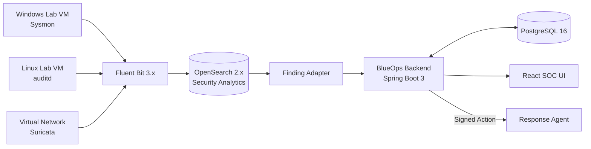

# BlueOps — Enterprise Threat Detection & Automated Incident Response Platform


BlueOps is a deployable Security Operations Center (SOC) platform engineered for real telemetry ingestion, event normalization, Sigma-based threat detection, multi-stage attack correlation, threat intelligence enrichment, and auditable, reversible incident response.

---

## Key Capabilities

1. **Multi-Source Endpoint & Network Telemetry:** Native collection configs for Windows Sysmon, Linux auditd/journald, and Suricata NIDS.
2. **Unified Event Schema:** Normalizes heterogeneous security events into the BlueOps Common Event Schema (v1.0.0).
3. **Deterministic Detection Engine:** 18 Sigma-compatible detection rules covering Windows, Linux, and Network tactics mapped directly to MITRE ATT&CK.
4. **Multi-Stage Attack Correlation:** Four stateful sequence correlation scenarios (e.g. Linux Account Compromise, Windows Process Injection Chains).
5. **Threat Intelligence Enrichment:** High-performance IOC indicator management (IP, Domain, URL, Hash) with automatic matching and confidence scoring.
6. **Analyst-Oriented SOC Dashboard:** React 18 + TypeScript + Tailwind dark-mode interface featuring SOC overview metrics, investigation workspaces, and interactive timelines.
7. **Constrained Response Orchestration:** Cryptographically signed (HMAC-SHA256) reversible response playbooks with multi-tier approval workflows.
8. **Empirical Performance Evaluation:** Benchmarked against Atomic Red Team attack simulations and benign workloads to calculate Precision, Recall, FPR, MTTD, and MTTR.

---

## Architecture Overview



---

## Directory Structure

```text
blueops/
├── infrastructure/       # Docker Compose, OpenSearch, Fluent Bit, Suricata, Sysmon/Auditd configs
├── detection-rules/      # Sigma rules (Windows, Linux, Network) and correlation scenarios
├── backend/              # Spring Boot 3 modular monolith (Java 21+)
├── frontend/             # React 18 + TypeScript + Tailwind CSS SOC dashboard
├── response-agent/       # Restricted, HMAC-authenticated Python response agent
├── test-lab/             # Atomic Red Team test scenarios and validation fixtures
├── scripts/              # Automated setup, verification, and benchmark scripts
└── docs/                 # Complete engineering design and deployment documentation
```

---

## Quick Start Guide

### Prerequisites
- Java 21+ (Java 23 supported)
- Node.js 20+
- Docker Desktop with Compose support
- 16 GB RAM host recommended

### 1. Start Infrastructure
```bash
cp .env.example .env
docker compose up -d postgres opensearch opensearch-dashboards fluent-bit
```

### 2. Start Backend
```bash
cd backend
./mvnw spring-boot:run
```

### 3. Start Frontend
```bash
cd frontend
npm install
npm run dev
```

Visit `http://localhost:3000` to access the BlueOps SOC Dashboard.

---

## License
Apache License 2.0. See [LICENSE](LICENSE) for details.
