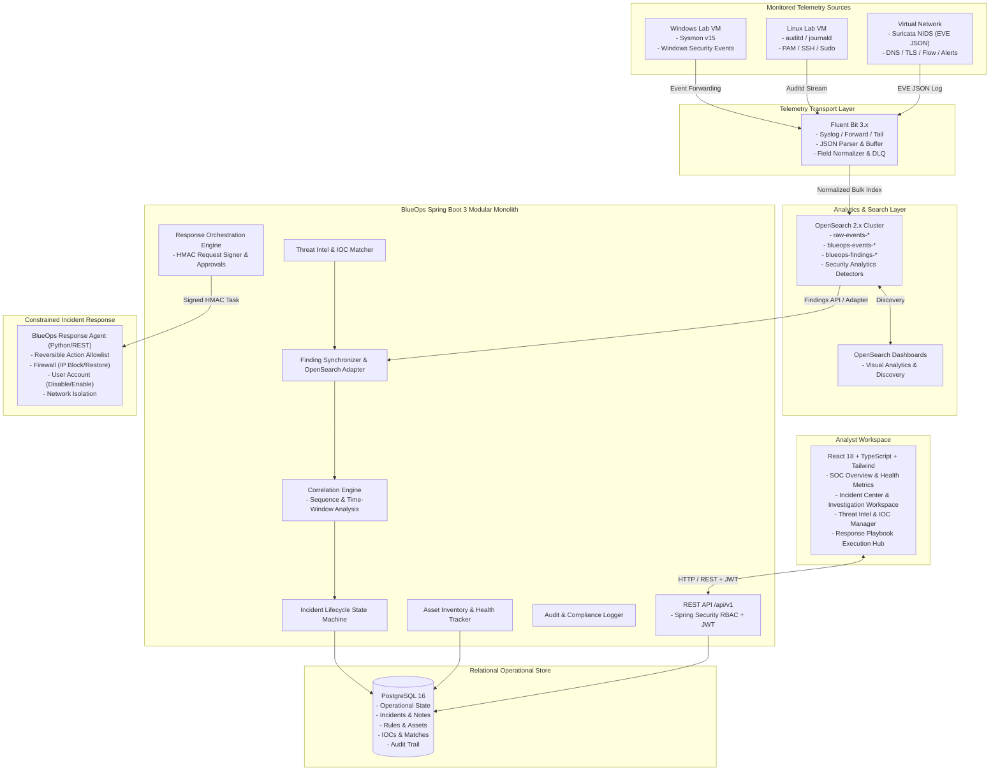

# BlueOps — System Architecture & Technical Specification

## 1. Executive Summary
**BlueOps** is an enterprise-grade Threat Detection and Automated Incident Response platform architected as a modular monolith. It ingests multi-source endpoint and network telemetry, normalizes events into a unified schema, performs deterministic Sigma-based threat detection and multi-stage sequence correlation, enriches alerts with threat intelligence, and enables analysts to conduct timeline investigations and trigger cryptographically-signed, reversible response playbooks.

---

## 2. End-to-End System Architecture

---

## 3. Data Flow & Processing Lifecycle

1. **Generation:**
   - Windows processes, network connections, and registry operations are recorded by Sysmon.
   - Linux authentication, execution, and privileged commands are recorded by `auditd`.
   - Network packets are inspected by Suricata to produce EVE JSON events (alerts, DNS, TLS).
2. **Collection & Ingestion:**
   - Fluent Bit collects raw events via TCP/Syslog/Tail.
   - Events are parsed, timestamped in UTC, buffered in memory/disk chunks, and pushed to OpenSearch.
3. **Normalization:**
   - Raw records are transformed into the **BlueOps Common Event Schema (v1.0.0)**.
   - Missing or malformed events are routed to a dead-letter index (`blueops-dlq-*`).
4. **Detection & Correlation:**
   - OpenSearch Security Analytics evaluates Sigma detection rules.
   - The Spring Boot backend retrieves findings via the OpenSearch Finding Adapter.
   - The backend Correlation Engine evaluates multi-stage attack scenarios across configurable time windows (e.g., C001 Linux Account Compromise, C002 Windows Execution Chain).
5. **Investigation & Triage:**
   - Analysts interact with the React SOC Dashboard.
   - Events, findings, timeline milestones, and asset contexts are presented in an integrated workspace.
6. **Controlled Response:**
   - Analyst initiates an allowlisted playbook (e.g., P001 Block IP, P002 Disable Account).
   - Backend requires multi-role approval for critical actions.
   - An expiring, HMAC-SHA256 signed action payload is dispatched to the isolated Response Agent.
   - The action is verified, execution telemetry is audited, and rollback steps are tracked.

---

## 4. Resource Allocation for 16 GB Laptop Host

| Component | CPU Allocation | Memory Limit | Heap / Process Limits |
|---|---|---|---|
| Host OS & IDE | 2 Cores | 5.0 GB | Host OS baseline |
| OpenSearch 2.x | 2 Cores | 2.5 GB | `-Xms1g -Xmx1g` |
| PostgreSQL 16 | 1 Core | 512 MB | `shared_buffers = 128MB` |
| Spring Boot Backend | 2 Cores | 1.0 GB | `-Xms256m -Xmx512m` |
| React Frontend | 1 Core | 256 MB | Static / Vite Preview |
| Fluent Bit | 0.5 Cores | 128 MB | In-memory chunk buffer 32MB |
| Response Agent | 0.5 Cores | 128 MB | Lightweight Python REST daemon |
| Windows / Linux Test Lab | 2 Cores | 4.0 - 5.0 GB | Alternating or lightweight testing VMs |
| **Total Estimated Peak** | **—** | **~14.5 GB** | **Within 16 GB Physical Ceiling** |
