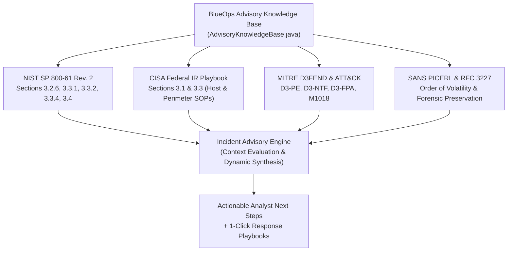
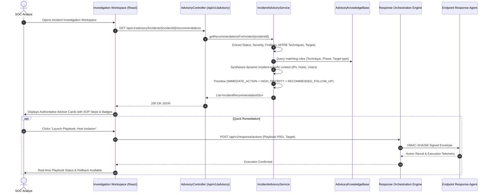

# BlueOps — Authoritative Incident Advisory System (AAS)
## Deterministic, Standard-Grounded Next Steps Engine for Enterprise Security Operations

---

## 1. Executive Summary & Design Rationale

In high-stakes Security Operations Center (SOC) environments, analyst decision fatigue and variance in tier-1/tier-2 triage quality represent major organizational liabilities. While generative AI and LLMs have emerged as popular tools, ungrounded probabilistic models introduce catastrophic failure modes:
1. **Hallucinatory Guidance:** Recommending non-existent CLI flags, improper mitigation actions, or destructive commands.
2. **Lack of Verifiable Provenance:** Providing advice without traceable regulatory or standard citations required by auditors and compliance frameworks.
3. **Execution Safety Violations:** Triggering response actions without adhering to RFC 3227 Order of Volatility or formal containment prerequisites.

**BlueOps Authoritative Incident Advisory System (AAS)** resolves this dilemma through a **deterministic, rule-driven recommendation engine** grounded strictly in globally recognized cybersecurity standards:
- **NIST Special Publication 800-61 Revision 2** (*Computer Security Incident Handling Guide*)
- **CISA Federal Incident Response Playbooks** (*Directives under Executive Order 14028*)
- **MITRE ATT&CK Mitigations & MITRE D3FEND Framework** (*NSA/MITRE Defensive Cybersecurity Knowledge Base*)
- **SANS PICERL Framework & IETF RFC 3227** (*Guidelines for Evidence Collection and Archiving*)

Every recommendation emitted by BlueOps contains an exact standard section citation, an authoritative rationale, an actionable standard operating procedure (SOP), and a direct one-click hook to BlueOps's cryptographically verified response playbooks.

---

## 2. Authoritative Source Taxonomy

The AAS knowledge base classifies every recommendation against one of six formal authorities:



### 2.1 Reputed Standards Catalog

| Source Enum | Full Official Title | Specific Standards Sections Cited |
|---|---|---|
| `NIST_SP_800_61R2` | NIST SP 800-61 Rev. 2 — Computer Security Incident Handling Guide | §3.2.6 Incident Prioritization, §3.3.1 Containment Strategy, §3.3.2 Evidence Handling, §3.3.4 Eradication, §3.4 Lessons Learned |
| `CISA_IR_PLAYBOOK` | CISA Federal Incident Response Playbook (EO 14028) | §3.1 Host/Endpoint Containment, §3.3 Perimeter & Network Indicator Blocking |
| `MITRE_D3FEND` | MITRE D3FEND Matrix (NSA/MITRE Matrix) | D3-PE (Process Eviction), D3-NTF (Network Traffic Filtering), D3-FPA (File Path Analysis), D3-SCA (System Configuration Analysis) |
| `MITRE_ATTACK_MITIGATION` | MITRE ATT&CK Enterprise Mitigations v14 | M1018 (User Account Management), M1042 (Disable or Remove Feature or Program), M1026 (Privileged Account Management) |
| `SANS_PICERL` | SANS Institute Incident Handler's Handbook (PICERL) | Phase 2 Identification & Scope, Phase 3 Containment, Phase 4 Eradication, Phase 5 Recovery |
| `RFC_3227` | IETF RFC 3227 — Best Current Practice (BCP 55) | §2.1 Order of Volatility (Registers/Cache → Memory → Network State → Ephemeral Files → Non-Volatile Storage) |

---

## 3. Architecture & Data Flow

The advisory pipeline operates across three integrated layers:



### 3.1 Context Evaluation Engine (`IncidentAdvisoryService.java`)
The advisory service synthesizes telemetry from:
1. **Incident State:** `NEW`, `TRIAGED`, `INVESTIGATING`, `CONTAINED`, `RESOLVED`, `CLOSED`.
2. **Incident Severity:** `CRITICAL`, `HIGH`, `MEDIUM`, `LOW`.
3. **Associated Findings & Rules:** Evaluates Sigma detection IDs (D001–D018) and MITRE tactics/techniques (e.g., T1059, T1003, T1071, T1548, T1110).
4. **Target Entities:** Automatically extracts affected hostnames, remote IP addresses, and user accounts from linked findings.

### 3.2 Dynamic Context Synthesis
When an incident involves specific targets (such as remote C2 `198.51.100.23` or host `SRV-APP-01`), the engine injects those exact values into the recommendation's rationale, title, and action parameters, allowing seamless execution without manual copy-pasting.

---

## 4. Advisory Knowledge Base Catalog

| Advisory ID | Primary Technique / Condition | Advisory Phase | Priority | Reputed Standard Citation | Mapped Playbook |
|---|---|---|---|---|:---:|
| `ADV-NET-001` | `T1071`, `T1071.001` (C2 Beaconing / High-Port Egress) | `CONTAINMENT` | `IMMEDIATE_ACTION` | CISA IR Playbook §3.3 & MITRE D3FEND D3-NTF | `P001` (Block Suspicious Lab IP) |
| `ADV-IAM-001` | `T1003.001`, `T1110`, `T1078` (Credential Theft/Dump) | `CONTAINMENT` | `IMMEDIATE_ACTION` | NIST SP 800-61R2 §3.3.1 & MITRE ATT&CK M1018 | `P002` (Disable Compromised Test Account) |
| `ADV-END-001` | `T1059`, `T1059.001`, `T1036`, `T1543` (Malicious Shells) | `CONTAINMENT` | `IMMEDIATE_ACTION` | CISA IR Playbook §3.1 & SANS PICERL Step 3 | `P003` (Isolate Suspicious Lab Endpoint) |
| `ADV-FOR-001` | `T1003.001`, `T1070.001`, `T1562.001` (Volatile State) | `DETECTION_AND_ANALYSIS` | `HIGH_PRIORITY` | RFC 3227 §2.1 & NIST SP 800-61R2 §3.3.2 | `P007` (Collect Endpoint Evidence Archive) |
| `ADV-POST-INCIDENT`| `RESOLVED` / `CLOSED` Incident Status | `POST_INCIDENT` | `STRATEGIC_HARDENING` | NIST SP 800-61R2 §3.4 (Lessons Learned) | — (Post-Mortem Review) |

---

## 5. Analyst Experience & SOC Console Integration

### 5.1 Interactive Investigation Workspace (`AuthoritativeAdvisor.tsx`)
In the **Investigation Workspace**, the advisory system is rendered prominently at the top of the incident view:
- **Authoritative Badge Bar:** Displays the governing standard (e.g., `NIST SP 800-61R2 §3.3.1`, `CISA IR Playbook §3.1`) with distinct visual color badges.
- **Priority Indicator:** Highlights urgency (`Immediate Action`, `High Priority`, `Recommended Follow-up`, `Strategic Hardening`).
- **Procedural Step-by-Step SOP:** Numbered checklist guiding the analyst through deterministic steps (e.g., preserving volatile triage memory prior to host disconnection).
- **One-Click Playbook Quick Action:** Buttons such as **"Launch Playbook: Host Isolation"** pre-fill the modal with verified targets and playbook parameters.

### 5.2 Regulatory & Executive Reporting Integration
When an analyst clicks **"Export Incident Report"** (Markdown or JSON) from the investigation workspace, the report automatically incorporates:
- The full list of evaluated authoritative recommendations.
- Standard citations and regulatory justifications.
- Complete SOP execution history and audit timestamps.

This ensures audit-ready compliance documentation for internal risk committees, external auditors, and cyber insurance underwriters.

---

## 6. Verification & Automated Test Coverage

The Authoritative Advisory System is verified by comprehensive backend and frontend automated test suites:

### 6.1 Backend JUnit 5 Tests (`IncidentAdvisoryServiceTest.java`)
- `shouldGenerateAuthoritativeRecommendationsForC2AndPrivEscalation()`:
  - Simulates an incident with C2 egress (`T1071`) and credential dumping (`T1003.001`).
  - Verifies that `CISA_IR_PLAYBOOK`, `MITRE_D3FEND`, and `NIST_SP_800_61R2` recommendations are generated.
  - Asserts that target IPs and usernames are synthesized correctly.
  - Confirms sorting by priority (`IMMEDIATE_ACTION` ahead of `RECOMMENDED_FOLLOW_UP`).
- `shouldProvidePostIncidentRecommendationsWhenIncidentResolved()`:
  - Verifies that when an incident transitions to `RESOLVED`, the engine pivots to `NIST SP 800-61R2 §3.4 Lessons Learned`.
- `shouldProvideStandardBaselineGuidanceForUnclassifiedScenarios()`:
  - Verifies that unclassified incidents receive standard RFC 3227 and NIST triage baselines without crashing.

### 6.2 Frontend Vitest Tests (`AuthoritativeAdvisor.test.tsx`)
- `renders authoritative recommendations with standard badges and steps`:
  - Verifies source badge rendering (`NIST SP 800-61R2`, `CISA Federal IR Playbook`).
  - Confirms SOP step checklist displays correctly.
- `triggers onLaunchPlaybook callback when action button is clicked`:
  - Asserts click delegation and payload transmission to parent investigation workspace modal.

---

## 7. Operational Instructions

### Fetching Recommendations via REST API
```http
GET /api/v1/advisory/incidents/1/recommendations HTTP/1.1
Host: localhost:8080
Authorization: Bearer <JWT_TOKEN>
```

**Response Payload (Sample):**
```json
[
  {
    "id": "ADV-C2-ISOLATE",
    "source": "CISA_IR_PLAYBOOK",
    "citation": "CISA Federal IR Playbook §3.1 & MITRE D3FEND D3-NTF",
    "phase": "CONTAINMENT",
    "priority": "IMMEDIATE_ACTION",
    "title": "Quarantine Compromised Endpoint (SRV-APP-01)",
    "rationale": "Active Command & Control telemetry or severe credential dumping indicates immediate adversary persistence.",
    "actionableSteps": [
      "Sever network connectivity via agent-based host isolation (P001) while preserving active memory.",
      "Verify isolation status using out-of-band management console.",
      "Prevent adversary lateral movement to domain controllers and critical asset segments."
    ],
    "suggestedPlaybookCode": "P001",
    "suggestedPlaybookName": "Host Isolation Playbook",
    "target": "SRV-APP-01",
    "mitreTechniques": ["T1071", "T1071.001"]
  }
]
```

### Ad-Hoc Advisory Analysis (Without Saved Incident)
```http
POST /api/v1/advisory/analyze HTTP/1.1
Host: localhost:8080
Content-Type: application/json
Authorization: Bearer <JWT_TOKEN>

{
  "techniques": ["T1003.001", "T1059.001"],
  "severity": "CRITICAL",
  "status": "INVESTIGATING",
  "assetHostname": "WKS-EXEC-04",
  "username": "SYSTEM"
}
```
