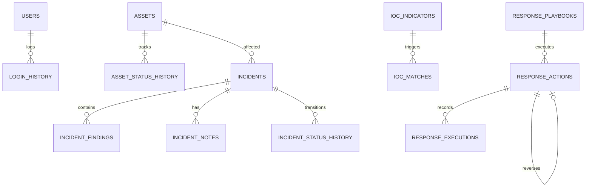

# BlueOps — Relational Database Schema Specification

## 1. Entity-Relationship Overview

---

## 2. Table Specifications

### 2.1 Identity & RBAC
- `users`: ID (PK), username (UNIQUE), email (UNIQUE), password_hash, full_name, role, enabled, created_at, updated_at.
- `login_history`: ID (PK), username, source_ip, user_agent, status, attempted_at.

### 2.2 Asset Inventory
- `assets`: ID (PK), persistent_id (UNIQUE), hostname, ip_address, os_name, os_version, environment, status, criticality, last_telemetry_at, created_at, updated_at.
- `asset_status_history`: ID (PK), asset_id (FK), previous_status, new_status, reason, changed_by, changed_at.

### 2.3 Detection Rules
- `detection_rules`: ID (PK), rule_code (UNIQUE), name, description, log_source, severity, mitre_tactic, mitre_technique_id, mitre_technique_name, status, query_dsl, sigma_yaml, false_positives, version.

### 2.4 Incidents & Findings
- `incidents`: ID (PK), incident_number (UNIQUE), title, description, severity, status, primary_asset_id (FK), assigned_to, created_by, resolution_rationale, created_at, updated_at, contained_at, resolved_at.
- `incident_findings`: ID (PK), incident_id (FK), opensearch_finding_id, rule_code, rule_name, severity, detected_at, raw_document_id, details_json.
- `incident_notes`: ID (PK), incident_id (FK), author, note_text, created_at.
- `incident_status_history`: ID (PK), incident_id (FK), from_status, to_status, actor, reason, transitioned_at.

### 2.5 Threat Intelligence
- `ioc_indicators`: ID (PK), indicator_value, indicator_type, source, confidence, severity, description, status, first_seen_at, last_seen_at, expires_at, tags (UNIQUE constraint on value + type).
- `ioc_matches`: ID (PK), ioc_id (FK), matched_value, asset_id (FK), event_timestamp, opensearch_doc_id, matched_field, incident_id (FK), created_at.

### 2.6 Response Orchestration
- `response_playbooks`: ID (PK), playbook_code (UNIQUE), name, description, action_type, requires_approval, target_type, rollback_supported.
- `response_actions`: ID (PK), action_uuid (UNIQUE), playbook_code (FK), incident_id (FK), target_identifier, target_asset_id (FK), requested_by, approval_status, approved_by, approved_at, execution_status, is_simulation, reversal_action_id (FK).
- `response_executions`: ID (PK), action_id (FK), executed_at, execution_duration_ms, success, status_code, response_payload, error_message, verification_passed.

### 2.7 Audit & Testing
- `audit_logs`: ID (PK), timestamp, actor, action, target_entity, target_id, source_ip, details.
- `test_runs`: ID (PK), run_uuid, test_scenario_code, scenario_name, started_at, completed_at, target_host, status, detection_observed, mttd_seconds, false_positives_observed, details.
