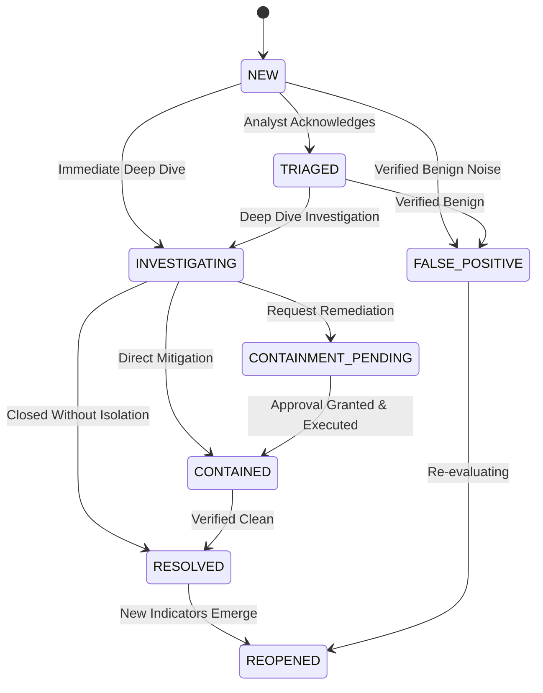

# BlueOps — Incident Response Playbook Guide

## 1. Incident Lifecycle & Finite State Machine

---

## 2. Standard Playbook Catalog

### P001 — Block Suspicious Lab IP
- **Action Type:** `BLOCK_IP`
- **Target:** External or internal IPv4 address
- **Authorization:** Requires Admin approval if triggered manually; auto-approved in automated test suites.
- **Rollback:** `RESTORE_IP` removes the firewall drop rule.

### P002 — Disable Compromised Test Account
- **Action Type:** `DISABLE_USER`
- **Target:** Username (e.g., `test_adversary` or `lab-user`)
- **Rollback:** `ENABLE_USER` restores login authorization.

### P003 — Isolate Suspicious Lab Endpoint
- **Action Type:** `ISOLATE_HOST`
- **Target:** Monitored Asset (e.g., `WIN-ASSET-001`, `LAB-WIN-01`)
- **Rollback:** `RECONNECT_HOST` restores normal network routing.
